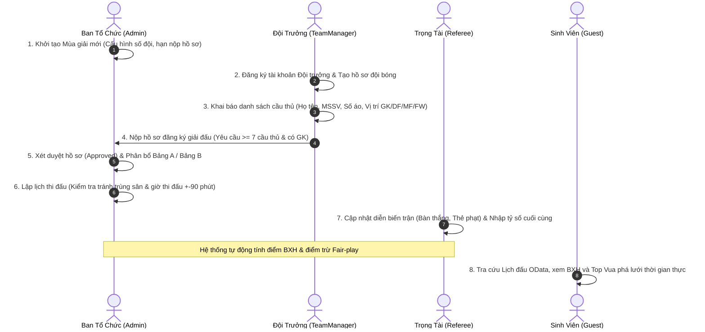
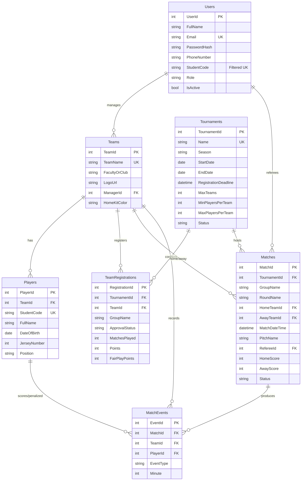

# TÀI LIỆU TOÀN DIỆN HỆ THỐNG QUẢN LÝ GIẢI BÓNG ĐÁ SINH VIÊN
## (STUDENT FOOTBALL LEAGUE MANAGEMENT SYSTEM)

**Môn học:** PRN232 - Building Cross-Platform Back-End Application With .NET (.NET 8.0)  
**Đề tài số:** 05 — Kiến trúc ASP.NET Core Web API, OData v8, JWT Bearer & ASP.NET Core MVC Client  
**Nhóm thực hiện:** 02 Thành viên (Mô hình Full-Stack chia đôi phân hệ)  
**Phiên bản tài liệu:** 1.0 — Ngày hoàn thiện: Tháng 11/2026

---

## MỤC LỤC TỔNG QUAN
1. [GIỚI THIỆU TỔNG QUAN VÀ MỤC TIÊU DỰ ÁN](#1-giới-thiệu-tổng-quan-và-mục-tiêu-dự-án)
2. [PHÂN TÍCH TÁC NHÂN (ACTORS) VÀ NGHIỆP VỤ HỆ THỐNG](#2-phân-tích-tác-nhân-actors-và-nghiệp-vụ-hệ-thống)
3. [KIẾN TRÚC HỆ THỐNG 4 TẦNG (SOLUTION ARCHITECTURE)](#3-kiến-trúc-hệ-thống-4-tầng-solution-architecture)
4. [THIẾT KẾ CƠ SỞ DỮ LIỆU (DATABASE & EF CORE)](#4-thiết-kế-cơ-sở-dữ-liệu-database--ef-core)
5. [ĐẶC TẢ TẦNG DỊCH VỤ WEB API & TRUY VẤN ODATA V8](#5-đặc-tả-tầng-dịch-vụ-web-api--truy-vấn-odata-v8)
6. [CÁC THUẬT TOÁN VÀ QUY TẮC NGHIỆP VỤ CỐT LÕI (BUSINESS LOGIC)](#6-các-thuật-toán-và-quy-tắc-nghiệp-vụ-cốt-lõi-business-logic)
7. [THIẾT KẾ ỨNG DỤNG WEBCLIENT MVC & THÀNH PHẦN GIAO DIỆN](#7-thiết-kế-ứng-dụng-webclient-mvc--thành-phần-giao-diện)
8. [HƯỚNG DẪN CÀI ĐẶT, VẬN HÀNH VÀ TÀI KHOẢN MẪU](#8-hướng-dẫn-cài-đặt-vận-hành-và-tài-khoản-mẫu)
9. [BỘ CÂU HỎI VẤN ĐÁP BẢO VỆ ĐỒ ÁN (PRN232 DEFENSE GUIDE)](#9-bộ-câu-hỏi-vấn-đáp-bảo-vệ-đồ-án-prn232-defense-guide)

---

## 1. GIỚI THIỆU TỔNG QUAN VÀ MỤC TIÊU DỰ ÁN

### 1.1. Bối cảnh đề tài
Tại các trường đại học, phong trào thể thao sinh viên (đặc biệt là bóng đá phong trào sân 7) diễn ra vô cùng sôi nổi theo từng học kỳ. Tuy nhiên, việc quản lý truyền thống qua giấy tờ, Excel hoặc mạng xã hội gặp rất nhiều bất cập:
- Đội bóng đăng ký chậm trễ, khó kiểm soát danh sách cầu thủ theo Mã số sinh viên (MSSV), dẫn đến hiện tượng "cầu thủ đá thuê" hoặc 1 sinh viên thi đấu cho nhiều đội khác nhau.
- Xếp lịch thi đấu thủ công dễ bị trùng giờ, trùng sân bãi hoặc các đội bóng không đủ thời gian nghỉ ngơi giữa các lượt trận.
- Thống kê tỷ số, bàn thắng, thẻ phạt và tính toán Bảng xếp hạng (Standings) sau mỗi trận tốn nhiều thời gian và dễ xảy ra sai sót khi xét các chỉ số phụ (hiệu số, đối đầu, điểm kỷ luật Fair-play).

### 1.2. Mục tiêu hệ thống
**Student Football League Management System** được xây dựng nhằm số hóa toàn diện quy trình tổ chức giải đấu, đáp ứng 100% chuẩn kỹ thuật môn học **PRN232**:
1. **Kiến trúc tách biệt (Decoupled Architecture):** Tách bạch hoàn toàn giữa Back-end Web API (xử lý dữ liệu & dịch vụ) và Front-end WebClient MVC (giao diện người dùng tiêu thụ dịch vụ).
2. **Chuẩn hóa truy vấn dữ liệu với OData v8:** Cho phép lọc linh hoạt (`$filter`), sắp xếp (`$orderby`), mở rộng quan hệ (`$expand`), phân trang (`$top`, `$skip`) trên lịch thi đấu, danh sách cầu thủ, bảng xếp hạng và Vua phá lưới.
3. **Bảo mật và phân quyền nghiêm ngặt:** Kết hợp JWT Bearer Token (trên Web API) và Cookie Identity (trên WebClient), phân quyền theo Role-Based Access Control (Admin, TeamManager, Referee, Guest).
4. **Tự động hóa vận hành:** Tự động phát hiện xung đột lịch sân $\pm 90$ phút, tự động tính lại Bảng xếp hạng và điểm Fair-play ngay khi trọng tài lưu kết quả trận đấu.

---

## 2. PHÂN TÍCH TÁC NHÂN (ACTORS) VÀ NGHIỆP VỤ HỆ THỐNG

### 2.1. Bảng đặc tả 4 Tác nhân (Actors)
| Tác nhân (Actor) | Mã Role | Quyền hạn trên Web API | Trách nhiệm trên WebClient |
| :--- | :---: | :--- | :--- |
| **Ban tổ chức (Admin)** | `Admin` | Toàn quyền CRUD Mùa giải; Phê duyệt/Từ chối hồ sơ đăng ký đội bóng; Phân bổ Bảng A / Bảng B; Lập lịch trận đấu; Xếp trọng tài điều khiển; Recalculate bảng điểm. | Giao diện Quản trị giải đấu (`/Admin/Tournaments`) và Điều hành lịch thi đấu (`/Admin/Matches`). |
| **Đội trưởng sinh viên (TeamManager)** | `TeamManager` | Tạo hồ sơ đội bóng của mình; Thêm/Sửa/Xóa cầu thủ trong đội; Gửi đăng ký tham gia mùa giải (khi còn hạn). Chặn quyền can thiệp vào đội bóng khác. | Màn hình Dashboard đội bóng (`/MyTeam/Dashboard`) kèm Modal popup thêm cầu thủ và theo dõi trạng thái duyệt. |
| **Trọng tài / Thư ký sân (Referee)** | `Referee` | Cập nhật trạng thái trận đấu (`Scheduled`, `InProgress`, `Completed`); Nhập tỷ số và ghi nhận sự kiện (Bàn thắng, Thẻ vàng, Thẻ đỏ). | Màn hình Nhập tỷ số & Ghi nhận sự kiện trận đấu (`/Admin/Matches`). |
| **Sinh viên / Khách vãng lai (Guest)** | `Guest` *(Anonymous)* | Xem thông tin giải đấu; Tra cứu lịch thi đấu và kết quả; Xem timeline chi tiết trận đấu; Xem Bảng xếp hạng và Top Vua phá lưới qua OData. | Trang chủ (`/Home/Index`), Trang Lịch đấu (`/Matches/Index`), Trang Chi tiết trận (`/Matches/Details/{id}`), Trang BXH (`/Standings/Index`). |

### 2.2. Luồng nghiệp vụ chính của hệ thống (Business Workflow)



---

## 3. KIẾN TRÚC HỆ THỐNG 4 TẦNG (SOLUTION ARCHITECTURE)

Hệ thống được tổ chức thành một Solution duy nhất gồm **4 Projects riêng biệt** nhằm đảm bảo nguyên tắc **Separation of Concerns (SoC)** và **Single Responsibility Principle (SRP)**:

```text
StudentFootballLeague.sln
│
├── 1. StudentFootballLeague.DataAccess (Class Library - .NET 8.0)
│   ├── Entities/                 # 8 Entities ánh xạ CSDL
│   └── Data/AppDbContext.cs      # Fluent API, Filtered Index, Restrict Cascade, Mapping View
│
├── 2. StudentFootballLeague.BusinessLogic (Class Library - .NET 8.0)
│   ├── DTOs/                     # Data Transfer Objects & Custom Validations
│   └── Services/                 # TokenService, MatchService, StandingsService
│
├── 3. StudentFootballLeague.API (ASP.NET Core Web API - .NET 8.0)
│   ├── Controllers/              # RESTful & OData Controllers (OData v8, EDM Model)
│   ├── Program.cs                # Cấu hình DI, OData, JWT Bearer, Swagger Bearer, CORS
│   └── appsettings.json          # ConnectionString, JWT Secret Key & Settings
│
└── 4. StudentFootballLeague.WebClient (ASP.NET Core MVC - .NET 8.0)
    ├── Services/                 # ApiClientService (HttpClientFactory), JwtAuthorizationHandler
    ├── TagHelpers/               # MatchStatusBadgeTagHelper (<match-status>)
    ├── Controllers/              # Home, Auth, Matches, Standings, MyTeam, Admin
    ├── Views/Shared/             # _Layout.cshtml, _MatchScoreCardPartial, _StandingsTablePartial...
    └── Program.cs                # Cookie Authentication, DelegatingHandler, Session
```

### 3.1. Sơ đồ phụ thuộc (Project Dependencies)
- `DataAccess`: Độc lập hoàn toàn, chỉ làm việc với EF Core và SQL Server.
- `BusinessLogic` $\rightarrow$ Tham chiếu `DataAccess` (truy cập DbContext và Entities).
- `API` $\rightarrow$ Tham chiếu `BusinessLogic` và `DataAccess` (cung cấp API endpoints).
- `WebClient` $\rightarrow$ **CHỈ tham chiếu `BusinessLogic`** (để dùng chung DTOs). **TUYỆT ĐỐI KHÔNG tham chiếu `DataAccess`**, đảm bảo tính độc lập 100% của tầng Client.

---

## 4. THIẾT KẾ CƠ SỞ DỮ LIỆU (DATABASE & EF CORE)

### 4.1. Sơ đồ Quan hệ Thực thể (ERD)



### 4.2. Đặc tả chi tiết 7 Bảng dữ liệu và Ràng buộc cốt lõi
1. **`Users`:** Quản lý tài khoản và phân quyền (`Admin`, `TeamManager`, `Referee`, `Guest`). Cột `StudentCode` được bảo vệ bởi **Filtered Unique Index** (`WHERE StudentCode IS NOT NULL`), cho phép Admin và Trọng tài có giá trị `NULL` mà không bao giờ bị lỗi vi phạm ràng buộc Unique.
2. **`Tournaments`:** Quản lý các mùa giải. Kiểm tra ràng buộc `EndDate > StartDate` và `RegistrationDeadline <= StartDate`.
3. **`Teams`:** Quản lý đội bóng sinh viên. Ràng buộc `ManagerId` tham chiếu tới `Users(UserId)`.
4. **`Players`:** Cầu thủ thuộc đội bóng. Composite Unique Index: `(TeamId, JerseyNumber)` đảm bảo trong một đội không bao giờ có 2 cầu thủ trùng số áo. Ràng buộc vị trí thi đấu: `Position IN ('GK', 'DF', 'MF', 'FW')`.
5. **`TeamRegistrations`:** Lưu hồ sơ đăng ký tham gia giải và điểm số Bảng xếp hạng (`MatchesPlayed`, `Wins`, `Draws`, `Losses`, `GoalsFor`, `GoalsAgainst`, `Points`, `FairPlayPoints`). Ràng buộc Composite Unique: `(TournamentId, TeamId)` ngăn 1 đội nộp đơn 2 lần cho cùng 1 giải đấu.
6. **`Matches`:** Lịch và kết quả thi đấu. **Có bổ sung cột `GroupName`** (ví dụ: 'Group A', 'Group B') để phục vụ truy vấn OData lọc theo bảng đấu. Cấu hình `DeleteBehavior.Restrict` cho khóa ngoại `HomeTeamId` và `AwayTeamId` để loại bỏ lỗi Multiple Cascade Paths trong SQL Server. Check Constraint: `HomeTeamId <> AwayTeamId`.
7. **`MatchEvents`:** Sự kiện diễn biến trận đấu (`Goal`, `OwnGoal`, `PenaltyGoal`, `YellowCard`, `RedCard`). Ràng buộc phút diễn ra: `Minute BETWEEN 1 AND 120`.

### 4.3. SQL View `V_PlayerStats` (Hỗ trợ OData Vua phá lưới)
```sql
CREATE VIEW V_PlayerStats AS
SELECT 
    p.PlayerId, p.FullName, p.StudentCode, p.JerseyNumber, p.Position,
    t.TeamId, t.TeamName, t.LogoUrl, m.TournamentId,
    COUNT(CASE WHEN me.EventType IN ('Goal', 'PenaltyGoal') THEN 1 END) AS GoalsScored,
    COUNT(CASE WHEN me.EventType = 'YellowCard' THEN 1 END) AS YellowCards,
    COUNT(CASE WHEN me.EventType = 'RedCard' THEN 1 END) AS RedCards
FROM Players p
INNER JOIN Teams t ON p.TeamId = t.TeamId
INNER JOIN MatchEvents me ON p.PlayerId = me.PlayerId
INNER JOIN Matches m ON me.MatchId = m.MatchId
GROUP BY p.PlayerId, p.FullName, p.StudentCode, p.JerseyNumber, p.Position, t.TeamId, t.TeamName, t.LogoUrl, m.TournamentId;
```

---

## 5. ĐẶC TẢ TẦNG DỊCH VỤ WEB API & TRUY VẤN ODATA V8

### 5.1. Danh mục Endpoints chi tiết
| Phân hệ | Phương thức & URL | OData | Quyền (Roles) | Mô tả chức năng |
| :--- | :--- | :---: | :---: | :--- |
| **Auth** | `POST /api/auth/register` | Không | Anonymous | Đăng ký tài khoản Đội trưởng mới |
| **Auth** | `POST /api/auth/login` | Không | Anonymous | Đăng nhập lấy JWT Bearer Token |
| **Auth** | `GET /api/auth/me` | Không | Authorize | Lấy thông tin cá nhân từ JWT Claims |
| **Tournaments** | `GET /api/tournaments` | Có | Public | Danh sách mùa giải (Lọc status, sắp xếp) |
| **Tournaments** | `POST /api/tournaments` | Không | `Admin` | Khởi tạo mùa giải mới |
| **Tournaments** | `PUT /api/tournaments/{id}` | Không | `Admin` | Cập nhật thông tin giải |
| **Tournaments** | `DELETE /api/tournaments/{id}`| Không | `Admin` | Xóa giải (khi chưa có trận đấu diễn ra) |
| **Tournaments** | `POST /api/tournaments/{id}/register` | Không | `TeamManager` | Nộp hồ sơ đăng ký tham gia giải |
| **Teams** | `GET /odata/Teams` | Có | Public | Tra cứu đội bóng (hỗ trợ `$expand=Players`) |
| **Teams** | `GET /api/teams/{id}` | Không | Public | Lấy chi tiết 1 đội bóng và đội hình |
| **Teams** | `GET /api/teams/my-team` | Không | `TeamManager` | Lấy hồ sơ đội bóng do Đội trưởng quản lý |
| **Teams** | `POST /api/teams` | Không | `TeamManager` | Tạo hồ sơ đội bóng mới |
| **Players** | `GET /odata/Players` | Có | Public | Tra cứu cầu thủ (Lọc vị trí, số áo, tên) |
| **Players** | `GET /api/teams/{teamId}/players` | Không | Public | Lấy danh sách cầu thủ thuộc 1 đội |
| **Players** | `POST /api/teams/{teamId}/players` | Không | `TeamManager,Admin` | Thêm cầu thủ (kiểm tra trùng số áo, MSSV) |
| **Players** | `DELETE /api/players/{id}` | Không | `TeamManager,Admin` | Xóa cầu thủ khỏi đội bóng |
| **Matches** | `GET /odata/Matches` | Có | Public | Lịch thi đấu & kết quả (lọc theo ngày, bảng) |
| **Matches** | `GET /api/matches/{id}` | Không | Public | Chi tiết trận đấu & timeline sự kiện |
| **Matches** | `POST /api/matches` | Không | `Admin` | Lập lịch trận đấu (chặn xung đột $\pm 90$p) |
| **Matches** | `PUT /api/matches/{id}/result`| Không | `Admin,Referee`| Cập nhật tỷ số, sự kiện & tự tính BXH |
| **Registrations**| `GET /api/registrations` | Không | `Admin` | Danh sách hồ sơ đội bóng chờ duyệt |
| **Registrations**| `PUT /api/registrations/{id}/approval` | Không | `Admin` | Duyệt / Từ chối đội bóng & chia bảng A/B |
| **Standings** | `GET /api/tournaments/{id}/standings` | Có | Public | Lấy Bảng xếp hạng theo từng bảng |
| **Standings** | `GET /api/tournaments/{id}/top-scorers` | Có | Public | Lấy danh sách Top Vua phá lưới |
| **Standings** | `GET /odata/PlayerStats` | Có | Public | OData EntitySet thống kê cầu thủ |

### 5.2. Ví dụ truy vấn OData chuẩn thực tế
1. **Lọc cầu thủ Tiền đạo (FW) thuộc Đội 1, sắp xếp theo số áo tăng dần:**
   `GET /odata/Players?$filter=TeamId eq 1 and Position eq 'FW'&$orderby=JerseyNumber asc`
2. **Tìm kiếm đội bóng có tên chứa chữ 'AI' kèm toàn bộ danh sách cầu thủ:**
   `GET /odata/Teams?$filter=contains(TeamName, 'AI')&$expand=Players`
3. **Lấy lịch thi đấu của Bảng A kèm đầy đủ thông tin đội nhà và đội khách:**
   `GET /odata/Matches?$filter=GroupName eq 'Group A'&$expand=HomeTeam,AwayTeam&$orderby=MatchDateTime asc`
4. **Lấy Top 3 cầu thủ ghi bàn nhiều nhất giải số 1 từ OData View:**
   `GET /odata/PlayerStats?$filter=TournamentId eq 1&$orderby=GoalsScored desc&$top=3`

---

## 6. CÁC THUẬT TOÁN VÀ QUY TẮC NGHIỆP VỤ CỐT LÕI (BUSINESS LOGIC)

### 6.1. Thuật toán kiểm tra Xung đột Lịch thi đấu (Schedule Conflict Detection)
Khi Admin tạo hoặc dời lịch một trận đấu tại thời điểm $T_{\text{new}}$:
- Hệ thống quét toàn bộ các trận đấu đang có trạng thái khác `'Cancelled'` trong cửa sổ thời gian:
  $$[T_{\text{new}} - 90\text{ phút}, \; T_{\text{new}} + 90\text{ phút}]$$
- Kiểm tra 2 điều kiện xung đột:
  1. **Xung đột sân:** $\text{PitchName}_{\text{new}} == \text{PitchName}_{\text{existing}} \rightarrow$ Báo lỗi: Sân bãi đang được sử dụng.
  2. **Xung đột đội:** $\text{Team}_{\text{new}} \cap \{\text{HomeTeam}, \text{AwayTeam}\}_{\text{existing}} \neq \emptyset \rightarrow$ Báo lỗi: Đội bóng chưa đủ thời gian nghỉ ngơi giữa 2 trận.

### 6.2. Thuật toán tự động tính lại Bảng xếp hạng & Điểm Fair-Play
Khi trận đấu chuyển sang trạng thái `'Completed'`, hàm `RecalculateStandingsAsync(tournamentId, groupName)` tự động:
1. Reset toàn bộ các chỉ số của các đội trong bảng đấu về 0.
2. Quét qua tất cả các trận đấu `'Completed'` trong bảng đó:
   - Cộng dồn số trận đã đấu (`MatchesPlayed++`).
   - Cộng bàn thắng (`GoalsFor`) và bàn thua (`GoalsAgainst`).
   - Tính điểm: Thắng $+3$, Hòa $+1$, Thua $+0$.
3. Quét bảng `MatchEvents` của các trận đấu đó để tính điểm kỷ luật **Fair-Play Points**:
   - Thẻ vàng (`YellowCard`): Trừ 1 điểm ($-1$).
   - Thẻ đỏ (`RedCard`): Trừ 3 điểm ($-3$).
4. Sắp xếp thứ hạng (Ranking) ưu tiên theo thứ tự:
   $$\text{Points (Giảm dần)} \rightarrow \text{GoalDifference (Giảm dần)} \rightarrow \text{GoalsFor (Giảm dần)} \rightarrow \text{FairPlayPoints (Tăng dần)}$$

### 6.3. Quy tắc điều lệ kiểm soát đăng ký
- **Khóa sổ theo hạn đăng ký:** Nếu thời gian hiện tại $> \text{RegistrationDeadline}$, hệ thống tự động khóa nút nộp đơn.
- **Điều kiện xét duyệt:** Đội bóng phải có tối thiểu 7 cầu thủ và bắt buộc phải có ít nhất 1 Thủ môn (`GK`) thì Admin mới có thể duyệt (`Approved`).

---

## 7. THIẾT KẾ ỨNG DỤNG WEBCLIENT MVC & THÀNH PHẦN GIAO DIỆN

### 7.1. Cơ chế xác thực Cookie Authentication kết hợp DelegatingHandler
- Khi người dùng đăng nhập tại `/Auth/Login`, WebClient gửi request tới `POST /api/auth/login`.
- Sau khi nhận chuỗi JWT, WebClient giải mã Claims (`NameIdentifier`, `Email`, `Role`, `TeamId`) và gọi:
  ```csharp
  await HttpContext.SignInAsync(CookieAuthenticationDefaults.AuthenticationScheme, claimsPrincipal, authProperties);
  ```
- Lớp `JwtAuthorizationHandler` (kế thừa `DelegatingHandler`) tự động trích xuất Token từ Cookie/Session và đính kèm vào Header `Authorization: Bearer <token>` trên mỗi request gửi sang API.

### 7.2. Các thành phần tái sử dụng (Reusable Components)
1. **PartialView `_MatchScoreCardPartial.cshtml`:** Hiển thị thẻ cặp đấu (Logo 2 đội, tỷ số trực tiếp, giờ thi đấu, sân bãi và nút xem chi tiết). Được tái sử dụng ở Trang chủ, Trang Lịch đấu và Chi tiết đội.
2. **PartialView `_StandingsTablePartial.cshtml`:** Hiển thị bảng xếp hạng bóng đá tiêu chuẩn (Trận, Thắng-Hòa-Thua, BT, BB, Hiệu số, Điểm, Fair-play), tự động **tô màu nền xanh lá (`table-success`) cho 2 đội đầu bảng** giành quyền vào vòng trong.
3. **PartialView `_PlayerFormModalPartial.cshtml`:** Form popup (Bootstrap 5 Modal) cho phép Đội trưởng thêm nhanh cầu thủ mà không cần tải lại trang.
4. **Custom TagHelper `<match-status status="..." />`:** Tự động sinh thẻ `<span class="badge">` với màu sắc và animation theo trạng thái:
   - `Scheduled` $\rightarrow$ Màu xám (`bg-secondary` - Sắp diễn ra)
   - `InProgress` $\rightarrow$ Màu đỏ nhấp nháy (`bg-danger animate-pulse` - ● Đang thi đấu)
   - `Completed` $\rightarrow$ Màu xanh lá (`bg-success` - Đã kết thúc)

---

## 8. HƯỚNG DẪN CÀI ĐẶT, VẬN HÀNH VÀ TÀI KHOẢN MẪU

### 8.1. Cấu hình CSDL SQL Server
1. Mở SQL Server Management Studio (SSMS).
2. Mở file script: `Database/StudentFootballLeagueDB.sql` và nhấn **Execute (F5)**.
3. CSDL `StudentFootballLeagueDB` sẽ được tạo mới cùng 7 bảng, 1 View và nạp đầy đủ dữ liệu mẫu.

### 8.2. Khởi chạy hệ thống bằng dòng lệnh (Terminal / PowerShell)

**Bước 1: Khởi chạy Web API**
```powershell
cd StudentFootballLeague.API
dotnet run
```
- Endpoint Swagger UI: [https://localhost:7108/swagger](https://localhost:7108/swagger) hoặc [http://localhost:5207/swagger](http://localhost:5207/swagger)

**Bước 2: Khởi chạy WebClient MVC** (Mở một cửa sổ Terminal mới)
```powershell
cd StudentFootballLeague.WebClient
dotnet run
```
- Giao diện Website: [https://localhost:7005](https://localhost:7005) hoặc [http://localhost:5237](http://localhost:5237)

### 8.3. Danh sách tài khoản thử nghiệm (Mật khẩu mặc định: `123456`)
| Vai trò | Email đăng nhập | Mật khẩu | Kịch bản trải nghiệm |
| :--- | :--- | :---: | :--- |
| **Ban tổ chức (Admin)** | `admin@fpt.edu.vn` | `123456` | Vào menu Quản trị BTC $\rightarrow$ Duyệt đội bóng Bảng A/B $\rightarrow$ Lập lịch đấu $\rightarrow$ Nhập tỷ số. |
| **Trọng tài (Referee)** | `referee1@fpt.edu.vn` | `123456` | Vào menu Điều hành trận đấu $\rightarrow$ Cập nhật tỷ số trận đấu và thêm sự kiện ghi bàn / thẻ phạt. |
| **Đội trưởng SE (TeamManager)** | `captain.se@fpt.edu.vn` | `123456` | Vào menu "Đội bóng của tôi" $\rightarrow$ Xem đội hình FC SE $\rightarrow$ Thêm cầu thủ mới $\rightarrow$ Đăng ký tham gia giải. |
| **Khách (Guest)** | *(Không cần đăng nhập)* | - | Xem trang chủ, tra cứu lịch đấu OData theo bảng/tên đội, xem BXH và Vua phá lưới. |

---

## 9. BỘ CÂU HỎI VẤN ĐÁP BẢO VỆ ĐỒ ÁN (PRN232 DEFENSE GUIDE)

### Câu 1: Tại sao nhóm tách Solution thành 4 Projects riêng biệt thay vì để chung?
> **Trả lời:** Nhóm áp dụng kiến trúc phân tầng (N-tier Architecture) nhằm tuân thủ nguyên tắc **Separation of Concerns (SoC)**. Việc tách riêng giúp:
> 1. `WebClient` không thể truy cập trực tiếp `AppDbContext` (ràng buộc ở mức compile-time).
> 2. Tái sử dụng toàn bộ DTOs và Validation logic giữa API và Client qua project `BusinessLogic`.
> 3. Hai thành viên có thể làm việc song song trên các project khác nhau mà không bị xung đột (conflict) trên Git.

### Câu 2: Khi nào thì nên dùng OData thay vì viết RESTful API truyền thống?
> **Trả lời:** OData cực kỳ mạnh mẽ khi phía Client cần tra cứu dữ liệu linh hoạt đa chiều (tìm kiếm, lọc nhiều điều kiện, sắp xếp, phân trang và mở rộng quan hệ). Thay vì Back-end phải tạo hàng chục endpoint rời rạc (`/api/players/by-team`, `/api/players/by-position`, `/api/players/paging`), OData chỉ cần 1 endpoint `/odata/Players` và Client tự truyền các tham số `$filter`, `$orderby`, `$expand`, `$top`, `$skip`.

### Câu 3: Làm thế nào để giải quyết lỗi xung đột route giữa OData và Swagger?
> **Trả lời:** Khi tích hợp OData v8, Swagger mặc định gặp lỗi `Conflicting method/path combination`. Nhóm đã xử lý triệt để trong `Program.cs` bằng cấu hình:
> `c.ResolveConflictingActions(apiDescriptions => apiDescriptions.First());`
> giúp Swagger tự động phân giải endpoint đại diện mà không bị lỗi 500.

### Câu 4: Nhóm xử lý trường hợp mã sinh viên (MSSV) của Admin và Trọng tài bị NULL trong SQL Server như thế nào?
> **Trả lời:** Trong SQL Server, một chỉ mục `UNIQUE` thông thường sẽ coi `NULL` là một giá trị và chỉ cho phép 1 bản ghi NULL duy nhất. Để khắc phục, nhóm sử dụng **Filtered Unique Index** trong EF Core Fluent API:
> `entity.HasIndex(u => u.StudentCode).IsUnique().HasFilter("[StudentCode] IS NOT NULL");`
> Nhờ đó, các tài khoản Admin/Referee có `StudentCode = NULL` thoải mái mà vẫn đảm bảo tính duy nhất tuyệt đối cho sinh viên.

### Câu 5: Hệ thống ngăn chặn việc lập lịch thi đấu trùng giờ như thế nào?
> **Trả lời:** Trong `MatchService.cs`, hệ thống thiết lập một khoảng kiểm tra $\pm 90$ phút quanh giờ thi đấu dự kiến. Nếu phát hiện cùng sân thi đấu hoặc 1 trong 2 đội bóng đang có trận đấu khác diễn ra trong khoảng này, hệ thống sẽ trả về lỗi `400 Bad Request` và nêu rõ lý do xung đột cụ thể.
