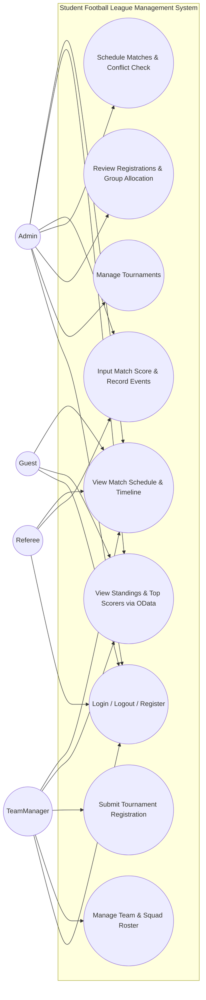
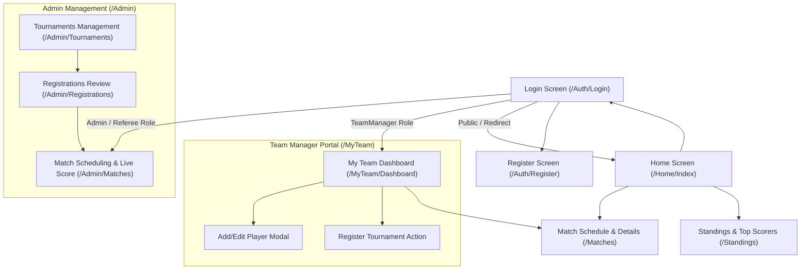
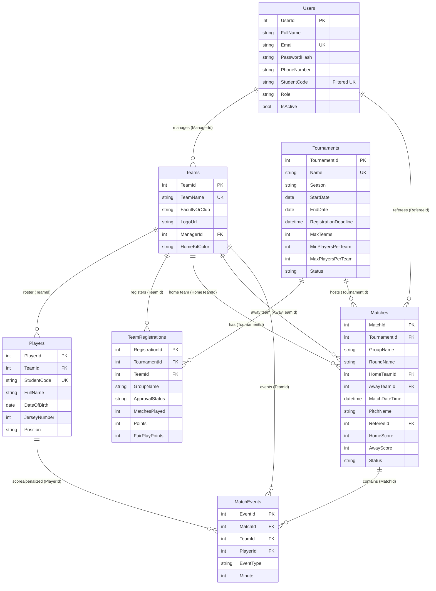

# FPT UNIVERSITY
## Requirement & Design Specification
### Student Football League Management System (SFLMS)
**Version:** 1.0  
**Course:** PRN232 - Building Cross-Platform Back-End Application With .NET (.NET 8.0)  
**Group:** Group 05  
- HE180001 – Member 1 (50%)
- HE180002 – Member 2 (50%)

---

## Table of Contents
- [I. Overview](#i-overview)
  - [1. User Requirements](#1-user-requirements)
    - [1.1 Actors](#11-actors)
    - [1.2 Use Cases](#12-use-cases)
      - [a. Diagram(s)](#a-diagrams)
      - [b. Descriptions](#b-descriptions)
  - [2. Overall Functionalities](#2-overall-functionalities)
    - [2.1 Screens Flow](#21-screens-flow)
    - [2.2 Screen Descriptions](#22-screen-descriptions)
    - [2.3 Screen Authorization](#23-screen-authorization)
    - [2.4 Database Design](#24-database-design)
      - [a. Database Schema](#a-database-schema)
      - [b. Table Descriptions](#b-table-descriptions)
- [II. Design Specifications](#ii-design-specifications)
  - [1. User Authentication (Login & JWT Token Issuance)](#1-user-authentication-login--jwt-token-issuance)
    - [1.1. Web Service](#11-web-service)
    - [1.2. Web Application](#12-web-application)
  - [2. Team Profile & Squad Roster Management](#2-team-profile--squad-roster-management)
    - [2.1. Web Service](#21-web-service)
    - [2.2. Web Application](#22-web-application)
  - [3. Tournament Registration & Admin Approval](#3-tournament-registration--admin-approval)
    - [3.1. Web Service](#31-web-service)
    - [3.2. Web Application](#32-web-application)
  - [4. Match Scheduling with Anti-Conflict Validation](#4-match-scheduling-with-anti-conflict-validation)
    - [4.1. Web Service](#41-web-service)
    - [4.2. Web Application](#42-web-application)
  - [5. Match Score, Event Recording & Auto-Standings Recalculation](#5-match-score-event-recording--auto-standings-recalculation)
    - [5.1. Web Service](#51-web-service)
    - [5.2. Web Application](#52-web-application)
  - [6. League Standings & Top Scorers via OData v8](#6-league-standings--top-scorers-via-odata-v8)
    - [6.1. Web Service](#61-web-service)
    - [6.2. Web Application](#62-web-application)

---

# I. Overview
The **Student Football League Management System (SFLMS)** is an enterprise-grade web application developed to digitalize, streamline, and automate university football tournament operations (7-a-side format). The system is built on a decoupled architecture utilizing **ASP.NET Core Web API (.NET 8.0)**, **OData v8**, **Entity Framework Core (Code-First)**, and **Microsoft SQL Server**, paired with a dedicated **ASP.NET Core MVC Client** implementing JWT Bearer and Cookie-based authentication.

The application eliminates paper-based team registrations, automates pitch scheduling to prevent overlaps ($\pm 90$-minute collision engine), and provides real-time standings recalculation and Fair-play disciplinary tracking.

---

## 1. User Requirements

### 1.1 Actors
| # | Actor | Description |
|---|---|---|
| 1 | **Admin (League Organizer)** | Full administrative access: creates/manages tournaments, reviews team applications, allocates approved teams into groups (Group A/B), schedules fixtures with collision verification, assigns referees, and triggers manual standing recalculations. |
| 2 | **TeamManager (Team Captain)** | Student team leader: manages their own team profile, maintains squad roster (validating Student Code format, age limits, and unique shirt numbers), and submits tournament entries before deadlines. Access is restricted exclusively to their assigned team. |
| 3 | **Referee (Match Official / Secretary)** | On-field coordinator: updates match statuses (`Scheduled`, `InProgress`, `Completed`), logs timeline incidents (goals, yellow/red cards with player attribution and minute), and submits final scores. |
| 4 | **Guest (Student / General Public)** | Unauthenticated public visitor: views tournaments, inspects OData-filtered fixtures and match results, examines live standings tables, and tracks the Golden Boot leaderboard. |

---

### 1.2 Use Cases

#### a. Diagram(s)



#### b. Descriptions
| ID | Feature | Use Case | Use Case Description |
|---|---|---|---|
| UC01 | Authentication | Login & Register | Users authenticate via email and password to receive JWT tokens. Team captains can self-register their accounts. |
| UC02 | Tournament Management | Manage Tournaments | Admin creates, edits, activates, and closes seasons, configuring date windows, team limits, and deadlines. |
| UC03 | Team Management | Manage Team Profile & Players | TeamManager creates team profile and manages squad roster (validates MSSV, age limits, shirt number uniqueness, and required GK). |
| UC04 | Registration Management | Submit Tournament Entry | TeamManager submits team registration for an active season (validates $\ge 7$ players and at least 1 GK) before deadline. |
| UC05 | Approval Management | Approve Registration & Grouping | Admin reviews team rosters, approves or rejects applications, and allocates approved teams into Group A or Group B. |
| UC06 | Match Management | Schedule Matches | Admin schedules fixtures between group teams, verifying pitch and team availability ($\pm 90$ mins gap) and assigning referees. |
| UC07 | Match Management | Record Score & Match Events | Referees or Admin log final scores and record cards/goals per player minute. System recalculates standings upon match completion. |
| UC08 | League Statistics | View Standings & Top Scorers | All users query standings, goal differences, fair-play penalties, and top goalscorers powered by OData v8 filters. |

---

## 2. Overall Functionalities

### 2.1 Screens Flow



---

### 2.2 Screen Descriptions
| # | Feature | Screen | Description |
|---|---|---|---|
| 1 | Authentication | Login (`/Auth/Login`) | Allows users to authenticate using Email and Password. Sets JWT token into an HTTP-only Cookie. |
| 2 | Authentication | Register (`/Auth/Register`) | Allows student team managers to register an account with student ID, email, password, and phone number. |
| 3 | Public Portal | Home (`/Home/Index`) | Displays featured tournaments, hero banner, upcoming marquee fixtures, and recent results. |
| 4 | Public Portal | Matches (`/Matches/Index`) | Displays match calendar with OData round/status filters and status badges (`Scheduled`, `InProgress`, `Completed`). |
| 5 | Public Portal | Match Detail (`/Matches/Details/{id}`) | Displays full match breakdown: line-ups, stadium, referee, and event timeline (goals, cards with minute). |
| 6 | Public Portal | Standings (`/Standings/Index`) | OData-powered standings table by Group (A/B) with PTS, GD, W/D/L, and Top Scorers ranking list. |
| 7 | Team Portal | Team Dashboard (`/MyTeam/Dashboard`) | Captains manage team info, logo, view current tournament status, and view squad roster. |
| 8 | Team Portal | Squad Roster Modal (`/MyTeam/AddPlayer`) | Form to register a player with Full Name, Student Code, Date of Birth, Jersey Number, and Position. |
| 9 | Admin Portal | Tournament Mgmt (`/Admin/Tournaments`) | Admin CRUD for tournaments, setting start/end dates, max teams, and registration deadlines. |
| 10 | Admin Portal | Registration Review (`/Admin/Registrations`) | Lists pending team applications; Admin approves/rejects and assigns Group A or Group B. |
| 11 | Admin Portal | Match Fixture Control (`/Admin/Matches`) | Form to schedule fixtures with automated pitch/referee collision checks. |
| 12 | Admin Portal | Match Result Entry (`/Admin/Matches`) | Modal for Referee/Admin to update final score, record event types, minute, and player IDs. |

---

### 2.3 Screen Authorization
| # | Screen | Admin | TeamManager | Referee | Guest |
|---|---|:---:|:---:|:---:|:---:|
| 1 | Login & Register | X | X | X | X |
| 2 | Home (`/Home/Index`) | X | X | X | X |
| 3 | Matches & Match Detail | X | X | X | X |
| 4 | Standings & Top Scorers | X | X | X | X |
| 5 | My Team Dashboard | | X | | |
| 6 | Player Roster Management | X | X | | |
| 7 | Submit Tournament Application | | X | | |
| 8 | Tournament Management | X | | | |
| 9 | Registration Review & Group Allocation | X | | | |
| 10 | Match Scheduling | X | | | |
| 11 | Match Result & Event Entry | X | | X | |

---

### 2.4 Database Design

#### a. Database Schema


#### b. Table Descriptions
| No | Table | Description | Primary Key | Foreign Keys & Unique Constraints |
|---|---|---|---|---|
| 01 | **Users** | Stores system user accounts across all roles (`Admin`, `TeamManager`, `Referee`, `Guest`). | `UserId` | UK: `Email`; Filtered UK: `StudentCode` (enforced when not NULL). |
| 02 | **Tournaments** | Manages tournament seasons, scheduling constraints, player quotas, and life-cycle status (`Upcoming`, `Ongoing`, `Finished`). | `TournamentId` | UK: `Name`. CK: `EndDate > StartDate`. |
| 03 | **Teams** | Manages team profiles, faculty affiliations, and ties to captain's account. | `TeamId` | FK: `ManagerId` $\rightarrow$ `Users(UserId)`. UK: `TeamName`. |
| 04 | **Players** | Stores athlete profiles enrolled in each team. | `PlayerId` | FK: `TeamId` $\rightarrow$ `Teams(TeamId)`. UK: `StudentCode`. Composite UK: `(TeamId, JerseyNumber)`. CK: `Position IN ('GK','DF','MF','FW')`. |
| 05 | **TeamRegistrations** | Records tournament applications, group assignments (`Group A`/`Group B`), and standing statistics. | `RegistrationId` | FK: `TournamentId` $\rightarrow$ `Tournaments(TournamentId)`, FK: `TeamId` $\rightarrow$ `Teams(TeamId)`. Composite UK: `(TournamentId, TeamId)`. |
| 06 | **Matches** | Contains schedule, allocated pitch, assigned referee, scores, and match state. | `MatchId` | FK: `TournamentId`, `HomeTeamId`, `AwayTeamId` (`DeleteBehavior.Restrict`), `RefereeId`. CK: `HomeTeamId <> AwayTeamId`. |
| 07 | **MatchEvents** | Records match incidents (`Goal`, `OwnGoal`, `PenaltyGoal`, `YellowCard`, `RedCard`) with timing and player links. | `EventId` | FK: `MatchId`, `TeamId`, `PlayerId`. CK: `Minute BETWEEN 1 AND 120`. |

---

# II. Design Specifications

## 1. User Authentication (Login & JWT Token Issuance)

### 1.1. Web Service
Validates user credentials and issues a signed JWT Bearer Token containing identity claims (`NameIdentifier`, `Email`, `Role`, `FullName`).

#### Endpoint
| URL | `/api/auth/login` |
|---|---|
| Method | **POST** |
| Body | `LoginRequestDto` (JSON) |
| Authorization | Public (Anonymous) |

#### Parameters (Request Body)
| Field | Type | Required | Description |
|---|---|:---:|---|
| `email` | string | Yes | Registered user email address (e.g., `admin@sflms.edu.vn`) |
| `password` | string | Yes | Plaintext password (verified against BCrypt/PBKDF2 hash) |

#### Request Example (cURL)
```bash
curl -X 'POST' \
  'http://localhost:5000/api/auth/login' \
  -H 'accept: application/json' \
  -H 'Content-Type: application/json' \
  -d '{
  "email": "admin@sflms.edu.vn",
  "password": "Password@123"
}'
```

#### Responses
| Status Code | Content |
|---|---|
| **200 OK** | JSON object containing JWT string (`token`), `expiration`, `userId`, `email`, `role`, and `fullName`. |
| **400 Bad Request** | Validation error (invalid email format or empty password field). |
| **401 Unauthorized** | Invalid credentials (non-existent email or incorrect password). |

#### Response Body Example (200 OK)
```json
{
  "token": "eyJhbGciOiJIUzI1NiIsInR5cCI6IkpXVCJ9.eyJuYW1laWQiOiIxIiwiZW1haWwiOiJhZG1pbkBzZmxtcy5lZHUudm4iLCJyb2xlIjoiQWRtaW4iLCJleHAiOjE3NjM1NjAwMDB9...",
  "expiration": "2026-11-09T05:00:00Z",
  "userId": 1,
  "fullName": "System Administrator",
  "email": "admin@sflms.edu.vn",
  "role": "Admin"
}
```

---

### 1.2. Web Application
The login interface renders a centered form for credentials entry. Upon successful submission, the client-side authentication handler writes the JWT to a secure HTTP-only Cookie and redirects users according to their role.

```text
+-------------------------------------------------------------+
|                STUDENT FOOTBALL LEAGUE                      |
|                                                             |
|                    +------------------+                     |
|                    |   System Login   |                     |
|                    +------------------+                     |
|                                                             |
|   Email Address:                                            |
|   [ admin@sflms.edu.vn                              ]       |
|                                                             |
|   Password:                                                 |
|   [ **********                                      ]       |
|                                                             |
|   [x] Remember Me                                           |
|                                                             |
|                    [      LOGIN      ]                      |
|                                                             |
|   Don't have an account? [Register as Team Captain]         |
+-------------------------------------------------------------+
```

| Field Name | Field Type | Description |
|---|---|---|
| `Email` | Text Box (Email) | Input field for user login email address. Required. |
| `Password` | Password Box | Masked input field for user password. Required. |
| `Remember Me` | Checkbox | Preserves persistent login session cookie. |
| `Login` | Button | Triggers HTTP POST authentication against the Web API. |
| `Register Link`| Hyperlink | Navigates captain candidates to the self-registration page. |

---

## 2. Team Profile & Squad Roster Management

### 2.1. Web Service
Allows team captains to fetch their squad roster or add a new athlete to the team, verifying that the student code is unique and the shirt number is not already taken in the team.

#### Endpoint
| URL | `/api/teams/{teamId}/players` |
|---|---|
| Method | **POST** |
| Body | `CreatePlayerDto` (JSON) |
| Authorization | Bearer Token (`TeamManager`, `Admin`) |

#### Parameters (Path & Request Body)
| Field | Location | Type | Required | Description |
|---|---|---|:---:|---|
| `teamId` | Path | int | Yes | Identifier of the target team |
| `studentCode` | Body | string | Yes | Unique Student ID (e.g., `HE180015`) |
| `fullName` | Body | string | Yes | Full name of the student athlete |
| `dateOfBirth` | Body | date | Yes | Birth date (student must be 18–26 years old) |
| `jerseyNumber`| Body | int | Yes | Shirt number (1 – 99) |
| `position` | Body | string | Yes | Position enum: `GK`, `DF`, `MF`, `FW` |

#### Request Example (cURL)
```bash
curl -X 'POST' \
  'http://localhost:5000/api/teams/1/players' \
  -H 'accept: application/json' \
  -H 'Authorization: Bearer <JWT_TOKEN>' \
  -H 'Content-Type: application/json' \
  -d '{
  "studentCode": "HE180015",
  "fullName": "Nguyen Van Dung",
  "dateOfBirth": "2004-05-12",
  "jerseyNumber": 10,
  "position": "FW"
}'
```

#### Responses
| Status Code | Content |
|---|---|
| **201 Created** | JSON of created Player entity with assigned `playerId`. |
| **400 Bad Request** | Jersey number already taken in this team, or student code is already registered in another team. |
| **403 Forbidden** | User is not the registered manager of this team. |

#### Response Body Example (201 Created)
```json
{
  "playerId": 24,
  "teamId": 1,
  "studentCode": "HE180015",
  "fullName": "Nguyen Van Dung",
  "dateOfBirth": "2004-05-12",
  "jerseyNumber": 10,
  "position": "FW"
}
```

---

### 2.2. Web Application
The **My Team Dashboard** displays team details and a responsive table of current players, with an "Add New Player" modal dialog.

```text
+-------------------------------------------------------------+
| My Team: FC FPT Titans              [ + Add Player ]        |
| Faculty: Software Engineering | Kit: Red / White            |
| Status: Tournament Approved   | Group: Group A              |
+-------------------------------------------------------------+
| #   | No. | Student ID | Full Name      | Pos | Action      |
| 1   | 1   | HE180001   | Tran Tuan Anh  | GK  | [Delete]    |
| 2   | 4   | HE180009   | Le Hoang Nam   | DF  | [Delete]    |
| 3   | 7   | HE180011   | Pham Duc Huy   | MF  | [Delete]    |
| 4   | 10  | HE180015   | Nguyen Van Dung| FW  | [Delete]    |
+-------------------------------------------------------------+
```

| Field Name | Field Type | Description |
|---|---|---|
| `Student Code` | Text Box | Validated university student ID format. |
| `Full Name` | Text Box | Athlete's full registered name. |
| `Date of Birth` | Date Picker | Date selector enforcing age bounds (18-26). |
| `Jersey Number`| Numeric Input | Positive integer between 1 and 99. |
| `Position` | Dropdown Select | Select option among Goalkeeper (GK), Defender (DF), Midfielder (MF), Forward (FW). |
| `Save Player` | Button | Submits modal form to API to register player. |

---

## 3. Tournament Registration & Admin Approval

### 3.1. Web Service
Admin reviews submitted team registrations and assigns the team to either Group A or Group B upon approval.

#### Endpoint
| URL | `/api/registrations/{registrationId}/approval` |
|---|---|
| Method | **PUT** |
| Body | `ApprovalRequestDto` (JSON) |
| Authorization | Bearer Token (`Admin` only) |

#### Parameters
| Field | Location | Type | Required | Description |
|---|---|---|:---:|---|
| `registrationId` | Path | int | Yes | Identifier of the registration record |
| `status` | Body | string | Yes | Approval status: `Approved` or `Rejected` |
| `groupName` | Body | string | Optional | Mandatory if approved: `Group A` or `Group B` |
| `adminNote` | Body | string | Optional | Reason for decision or rejection note |

#### Responses
| Status Code | Content |
|---|---|
| **200 OK** | Updated registration JSON detailing new status and group name. |
| **400 Bad Request** | Team does not have minimum required players ($\ge 7$) or lacks a Goalkeeper (GK). |
| **404 Not Found** | Registration ID does not exist. |

#### Response Body Example (200 OK)
```json
{
  "registrationId": 5,
  "tournamentId": 1,
  "teamId": 2,
  "teamName": "FC Information Assurance",
  "approvalStatus": "Approved",
  "groupName": "Group A",
  "matchesPlayed": 0,
  "points": 0,
  "fairPlayPoints": 0
}
```

---

### 3.2. Web Application
Admin Registration Review screen listing all pending applications with squad readiness counters.

```text
+---------------------------------------------------------------------------------+
| Tournament Registration Review                                                  |
+---------------------------------------------------------------------------------+
| Team Name        | Faculty/Club | Roster Count | Action                         |
| FC IA Warriors   | Security     | 9 (Valid GK) | Group: [Group A v] [Approve]   |
| FC Biz Elite     | Business     | 5 (Too Low)  | Group: [Group B v] [Reject]    |
+---------------------------------------------------------------------------------+
```

| Field Name | Field Type | Description |
|---|---|---|
| `Team Name` | Text / Badge | Name of the applying team and faculty affiliation. |
| `Roster Count` | Number Badge | Color-coded badge (Green if $\ge 7$, Red if $< 7$). |
| `Group Assignment` | Dropdown Select | Options: `Group A`, `Group B`. |
| `Approve Button` | Action Button | Approves registration and locks team into the group. |
| `Reject Button` | Action Button | Opens modal to input rejection reason sent to manager. |

---

## 4. Match Scheduling with Anti-Conflict Validation

### 4.1. Web Service
Schedules a tournament match between two teams belonging to the same group, strictly checking that neither pitch nor teams have conflicts within a $\pm 90$-minute window.

#### Endpoint
| URL | `/api/matches` |
|---|---|
| Method | **POST** |
| Body | `CreateMatchDto` (JSON) |
| Authorization | Bearer Token (`Admin` only) |

#### Parameters
| Field | Type | Required | Description |
|---|---|:---:|---|
| `tournamentId` | int | Yes | Target tournament ID |
| `groupName` | string | Yes | `Group A` or `Group B` |
| `roundName` | string | Yes | e.g., `Round 1`, `Round 2`, `Semi-Final` |
| `homeTeamId` | int | Yes | ID of Home Team |
| `awayTeamId` | int | Yes | ID of Away Team (Must differ from HomeTeamId) |
| `matchDateTime`| datetime | Yes | Kick-off time |
| `pitchName` | string | Yes | Assigned pitch (e.g., `Pitch 1 (FPT Stadium)`) |
| `refereeId` | int | Yes | User ID of designated referee |

#### Responses
| Status Code | Content |
|---|---|
| **201 Created** | JSON object of scheduled fixture. |
| **400 Bad Request** | Pitch collision detected within $\pm 90$ mins, or teams are not in the same group. |

---

### 4.2. Web Application
Admin scheduling form with datetime pickers and dropdown selectors for teams, pitches, and referees.

| Field Name | Field Type | Description |
|---|---|---|
| `Tournament` | Dropdown | Selects active tournament. |
| `Group` | Dropdown | `Group A` or `Group B`. |
| `Home Team` | Dropdown | Filtered list of approved teams in the selected group. |
| `Away Team` | Dropdown | Filtered list excluding selected Home Team. |
| `Match Time` | DateTime Picker | Calendar and time picker for fixture kick-off. |
| `Pitch` | Dropdown | Stadium field selection (`Pitch 1`, `Pitch 2`). |
| `Referee` | Dropdown | Selects certified official from `Users` table. |

---

## 5. Match Score, Event Recording & Auto-Standings Recalculation

### 5.1. Web Service
Updates the match result, logs specific timeline incidents (goals, yellow/red cards), and automatically triggers database standing recalculations.

#### Endpoint
| URL | `/api/matches/{id}/result` |
|---|---|
| Method | **PUT** |
| Body | `UpdateMatchResultDto` (JSON) |
| Authorization | Bearer Token (`Admin`, `Referee`) |

#### Request Example (cURL)
```bash
curl -X 'PUT' \
  'http://localhost:5000/api/matches/1/result' \
  -H 'accept: application/json' \
  -H 'Authorization: Bearer <JWT_TOKEN>' \
  -H 'Content-Type: application/json' \
  -d '{
  "homeScore": 2,
  "awayScore": 1,
  "status": "Completed",
  "events": [
    {
      "teamId": 1,
      "playerId": 24,
      "eventType": "Goal",
      "minute": 23
    },
    {
      "teamId": 2,
      "playerId": 35,
      "eventType": "YellowCard",
      "minute": 41
    },
    {
      "teamId": 1,
      "playerId": 24,
      "eventType": "Goal",
      "minute": 58
    }
  ]
}'
```

#### Responses
| Status Code | Content |
|---|---|
| **200 OK** | Success message; standings and Fair-play penalty points updated. |
| **400 Bad Request** | Invalid event minute ($<1$ or $>120$) or invalid player ID. |

---

### 5.2. Web Application
Referee Live Control Screen allowing quick scoring and live event addition.

```text
+-------------------------------------------------------------+
| Match #01 - Round 1 (Group A)               [ Status: LIVE ]|
|                                                             |
|     FC TITANS             2  -  1        FC IA WARRIORS     |
|                                                             |
| Timeline Events:                                            |
| [ 23' ] GOAL - Nguyen Van Dung (#10 FC Titans)              |
| [ 41' ] YELLOW CARD - Tran Minh Tri (#8 FC IA)              |
| [ 58' ] GOAL - Nguyen Van Dung (#10 FC Titans)              |
|                                                             |
| + Add Event:                                                |
| Team: [FC Titans v] Player: [Nguyen Van Dung v]             |
| Type: [Goal      v] Minute: [ 58 ]  [ + Add Event ]         |
|                                                             |
|              [ SUBMIT FINAL RESULT & COMPLETE ]             |
+-------------------------------------------------------------+
```

| Field Name | Field Type | Description |
|---|---|---|
| `Home Score` | Number Input | Final/Current score for home team. |
| `Away Score` | Number Input | Final/Current score for away team. |
| `Event Type` | Dropdown | Selection: `Goal`, `YellowCard`, `RedCard`, `OwnGoal`. |
| `Player` | Dropdown | Selects athlete involved in incident. |
| `Minute` | Number Input | Match minute when incident occurred ($1 - 120$). |
| `Submit Final` | Action Button | Completes match and executes standing update engine. |

---

## 6. League Standings & Top Scorers via OData v8

### 6.1. Web Service
Exposes OData v8 endpoints for rich querying of tournament rankings and goal statistics.

#### Endpoint
| URL | `/odata/Standings?$filter=TournamentId eq 1 and GroupName eq 'Group A'&$orderby=Points desc,GoalDifference desc` |
|---|---|
| Method | **GET** |
| Authorization | Public (Anonymous) |

#### OData Query Capabilities
- `$filter`: Filter by `TournamentId`, `GroupName`.
- `$orderby`: Sort by `Points desc`, `GoalDifference desc`, `FairPlayPoints desc`.
- `$expand`: Expand related team entities.

#### Response Body Example (200 OK)
```json
{
  "@odata.context": "http://localhost:5000/odata/$metadata#Standings",
  "value": [
    {
      "registrationId": 1,
      "tournamentId": 1,
      "teamId": 1,
      "teamName": "FC FPT Titans",
      "groupName": "Group A",
      "matchesPlayed": 3,
      "won": 3,
      "drawn": 0,
      "lost": 0,
      "goalsFor": 8,
      "goalsAgainst": 2,
      "goalDifference": 6,
      "points": 9,
      "fairPlayPoints": -2
    },
    {
      "registrationId": 5,
      "tournamentId": 1,
      "teamId": 2,
      "teamName": "FC Information Assurance",
      "groupName": "Group A",
      "matchesPlayed": 3,
      "won": 2,
      "drawn": 0,
      "lost": 1,
      "goalsFor": 5,
      "goalsAgainst": 4,
      "goalDifference": 1,
      "points": 6,
      "fairPlayPoints": -5
    }
  ]
}
```

---

### 6.2. Web Application
Public standings page presenting interactive tabs for Group A and Group B, accompanied by a leaderboard widget for the Golden Boot (Top Scorers).

```text
+---------------------------------------------------------------------------------------+
| LEAGUE STANDINGS - TOURNAMENT 2026                                                    |
| [ Group A (Active) ]  [ Group B ]                                                     |
+---------------------------------------------------------------------------------------+
| Pos | Team Name           | Pld | W | D | L | GF | GA | GD | PTS | Fair-Play | Form   |
| 1   | FC FPT Titans       | 3   | 3 | 0 | 0 | 8  | 2  | +6 | 9   | -2        | W-W-W  |
| 2   | FC IA Warriors      | 3   | 2 | 0 | 1 | 5  | 4  | +1 | 6   | -5        | W-L-W  |
| 3   | FC Software Eng     | 3   | 1 | 0 | 2 | 3  | 5  | -2 | 3   | -1        | L-W-L  |
| 4   | FC Graphic Design   | 3   | 0 | 0 | 3 | 1  | 6  | -5 | 0   | -4        | L-L-L  |
+---------------------------------------------------------------------------------------+
```

| Field Name | Field Type | Description |
|---|---|---|
| `Group Tabs` | Tab Navigation | Toggles view between Group A and Group B. |
| `PTS / GD / W-D-L` | Data Table | Renders standard league table metrics. |
| `Fair-Play Score` | Data Column | Disciplinary penalty points based on card count (-1 for Yellow, -3 for Red). |
| `Top Scorers Leaderboard`| Sidebar Widget | Lists top 5 players sorted by goals scored with team logos. |
