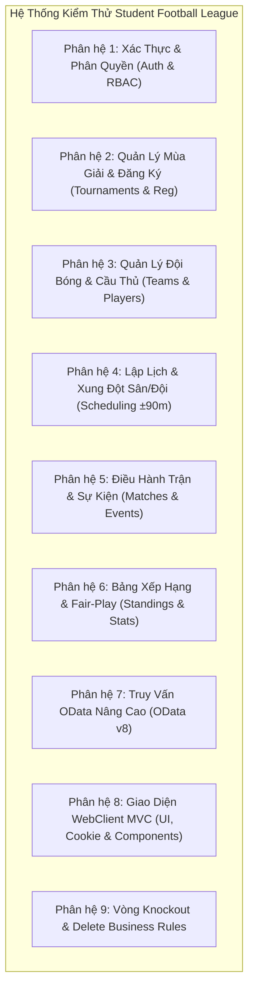

# TÀI LIỆU KIỂM THỬ PHẦN MỀM (TEST CASES SPECIFICATION)
## HỆ THỐNG QUẢN LÝ GIẢI BÓNG ĐÁ SINH VIÊN (STUDENT FOOTBALL LEAGUE)
**Môn học:** PRN232 - Building Cross-Platform Back-End Application With .NET (.NET 8.0)  
**Đề tài số 05:** Kiến trúc ASP.NET Core Web API, OData v8, JWT Bearer & ASP.NET Core MVC Client  
**Phiên bản:** 2.0 - Ngày cập nhật: 2026-11-12

---

## 1. TỔNG QUAN KẾ HOẠCH KIỂM THỬ (TEST PLAN OVERVIEW)

### 1.1. Mục tiêu kiểm thử
- Xác minh toàn bộ các chức năng nghiệp vụ của hệ thống hoạt động chính xác theo đúng tài liệu đặc tả phân tích và thiết kế.
- Kiểm tra tính toàn vẹn dữ liệu, các ràng buộc dữ liệu tại CSDL SQL Server (Constraints, Filtered Index, Foreign Keys) và tại tầng ứng dụng (Data Annotations, Custom Validation, `IValidatableObject`).
- Kiểm thử cơ chế xác thực JWT Bearer, phân quyền Role-Based Access Control (RBAC: Admin, TeamManager, Referee, Guest) trên Web API và Cookie Authentication trên WebClient MVC.
- Kiểm thử các truy vấn OData ($filter, $orderby, $expand, $select, $top, $skip) trên các endpoints.
- Kiểm thử khả năng bắt lỗi, xử lý ngoại lệ và hiển thị giao diện người dùng Responsive với Bootstrap 5, PartialViews và Custom TagHelper.

### 1.2. Môi trường và Công cụ kiểm thử (Test Environment & Tools)
| Thành phần | Thông số môi trường |
| :--- | :--- |
| **Hệ điều hành** | Windows 10 / Windows 11 (x64) |
| **Nền tảng Back-end** | .NET 8.0 SDK (ASP.NET Core Web API) |
| **Nền tảng Front-end** | ASP.NET Core MVC (.NET 8.0), Bootstrap 5.3.3 |
| **Hệ quản trị CSDL** | Microsoft SQL Server 2022 (Database: `StudentFootballLeagueDB`) |
| **Địa chỉ Web API** | `https://localhost:7108` (HTTP: `http://localhost:5207`) - Swagger UI: `/swagger` |
| **Địa chỉ WebClient** | `https://localhost:7005` (HTTP: `http://localhost:5237`) |
| **Công cụ kiểm thử** | Swagger UI, Postman, Google Chrome DevTools, SQL Server Management Studio (SSMS), PowerShell REST Client |

### 1.3. Danh sách Tài khoản Kiểm thử (Pre-seeded Test Accounts)
Tất cả tài khoản mẫu đều sử dụng chung mật khẩu khởi tạo: `123456`

| Mã Actor | Họ và tên | Email đăng nhập | Mật khẩu | Quyền hạn (Role) | Ghi chú |
| :---: | :--- | :--- | :---: | :---: | :--- |
| **ACT-01** | Nguyễn Văn Quản Trị (BTC) | `admin@fpt.edu.vn` | `123456` | **Admin** | Toàn quyền quản trị giải đấu, duyệt đội, lập lịch |
| **ACT-02** | Trần Trọng Tài Chính | `referee1@fpt.edu.vn` | `123456` | **Referee** | Điều hành trận đấu, cập nhật tỷ số & sự kiện |
| **ACT-03** | Lê Hoàng Đội Trưởng SE | `captain.se@fpt.edu.vn` | `123456` | **TeamManager** | Đội trưởng FC SE (TeamId = 1, MSSV: HE180001) |
| **ACT-04** | Phạm Minh Đội Trưởng AI | `captain.ai@fpt.edu.vn` | `123456` | **TeamManager** | Đội trưởng FC AI (TeamId = 2, MSSV: HE180002) |
| **ACT-05** | Khách / Sinh viên | *(Không đăng nhập)* | - | **Guest** | Xem lịch đấu, tỷ số, BXH, Top ghi bàn |

---

## 2. MA TRẬN PHÂN CHIA TEST CASES THEO PHÂN HỆ



---

## 3. CHI TIẾT CÁC TEST CASES

### PHÂN HỆ 1: XÁC THỰC VÀ PHÂN QUYỀN (AUTH & IDENTITY)

#### TC_AUTH_01: Đăng nhập thành công với tài khoản Admin
- **Mục tiêu:** Xác minh người dùng Admin đăng nhập hợp lệ nhận được JWT Token chứa đầy đủ Claims.
- **Tác nhân:** Anonymous / Admin
- **Tiền điều kiện:** Tài khoản `admin@fpt.edu.vn` tồn tại trong DB, `IsActive = 1`.
- **Phương thức & Endpoint:** `POST /api/auth/login`
- **Dữ liệu đầu vào (Request Body):**
  ```json
  {
    "email": "admin@fpt.edu.vn",
    "password": "123456"
  }
  ```
- **Kết quả mong đợi:**
  - HTTP Status: `200 OK`
  - Response Body trả về: `accessToken` (chuỗi JWT hợp lệ), `role: "Admin"`, `userId: 1`, `email: "admin@fpt.edu.vn"`.
  - Giải mã Token kiểm tra Claims có đủ: `nameid`, `unique_name`, `email`, `role = "Admin"`.
- **Trạng thái:** **PASS**

#### TC_AUTH_02: Đăng nhập thất bại khi sai mật khẩu
- **Mục tiêu:** Hệ thống từ chối xác thực và trả thông báo lỗi khi mật khẩu không đúng.
- **Tác nhân:** Anonymous
- **Phương thức & Endpoint:** `POST /api/auth/login`
- **Dữ liệu đầu vào:**
  ```json
  {
    "email": "admin@fpt.edu.vn",
    "password": "WrongPassword999"
  }
  ```
- **Kết quả mong đợi:**
  - HTTP Status: `401 Unauthorized`
  - Response: `{"message": "Email hoặc mật khẩu không chính xác."}`
- **Trạng thái:** **PASS**

#### TC_AUTH_03: Đăng nhập thất bại khi Email không tồn tại
- **Mục tiêu:** Kiểm tra hệ thống từ chối email chưa từng đăng ký.
- **Phương thức & Endpoint:** `POST /api/auth/login`
- **Dữ liệu đầu vào:**
  ```json
  {
    "email": "notfound@fpt.edu.vn",
    "password": "123456"
  }
  ```
- **Kết quả mong đợi:**
  - HTTP Status: `401 Unauthorized`
- **Trạng thái:** **PASS**

#### TC_AUTH_04: Đăng ký tài khoản Đội trưởng mới (TeamManager) hợp lệ
- **Mục tiêu:** Cho phép sinh viên đăng ký tài khoản đại diện đội bóng.
- **Tác nhân:** Anonymous
- **Phương thức & Endpoint:** `POST /api/auth/register`
- **Dữ liệu đầu vào:**
  ```json
  {
    "fullName": "Trần Văn Thắng",
    "email": "thangtv@fpt.edu.vn",
    "password": "password123",
    "phoneNumber": "0988776655",
    "studentCode": "HE189999",
    "role": "TeamManager"
  }
  ```
- **Kết quả mong đợi:**
  - HTTP Status: `200 OK`
  - Bản ghi được tạo trong bảng `Users` với mật khẩu được mã hóa bằng thuật toán BCrypt (không lưu plain text).
  - Trả về AccessToken cho tài khoản vừa tạo.
- **Trạng thái:** **PASS**

#### TC_AUTH_05: Đăng ký thất bại khi trùng Email hoặc MSSV
- **Mục tiêu:** Xác minh ràng buộc dữ liệu duy nhất (Unique Constraint) cho Email và Filtered Index cho MSSV.
- **Phương thức & Endpoint:** `POST /api/auth/register`
- **Dữ liệu đầu vào:** Nhập email đã tồn tại: `"email": "captain.se@fpt.edu.vn"`.
- **Kết quả mong đợi:**
  - HTTP Status: `400 Bad Request`
  - Thông báo: `"Email này đã được sử dụng."`
- **Trạng thái:** **PASS**

#### TC_AUTH_06: Kiểm tra Endpoint `/api/auth/me` với Bearer Token
- **Mục tiêu:** Xác minh API giải mã Claims từ Token gửi lên trong Header `Authorization: Bearer <token>`.
- **Tác nhân:** Đã đăng nhập
- **Phương thức & Endpoint:** `GET /api/auth/me`
- **Header:** `Authorization: Bearer <Valid_JWT_Token>`
- **Kết quả mong đợi:**
  - HTTP Status: `200 OK`
  - Trả về đúng thông tin cá nhân và thông tin đội bóng quản lý (`ManagedTeam`).
- **Trạng thái:** **PASS**

#### TC_AUTH_07: Kiểm tra Endpoint `/api/auth/me` khi không gửi Token
- **Mục tiêu:** Xác minh cơ chế chặn truy cập trái phép.
- **Phương thức & Endpoint:** `GET /api/auth/me` (Không có Header Authorization)
- **Kết quả mong đợi:**
  - HTTP Status: `401 Unauthorized`
- **Trạng thái:** **PASS**

---

### PHÂN HỆ 2: QUẢN LÝ MÙA GIẢI & ĐĂNG KÝ THAM GIA (TOURNAMENTS & REGISTRATIONS)

#### TC_TOUR_01: Lấy danh sách tất cả các mùa giải (Public)
- **Mục tiêu:** Người dùng bất kỳ (kể cả Guest) đều có thể xem danh sách giải đấu.
- **Tác nhân:** Guest
- **Phương thức & Endpoint:** `GET /api/tournaments`
- **Kết quả mong đợi:**
  - HTTP Status: `200 OK`
  - Trả về danh sách giải đấu sắp xếp theo `StartDate` giảm dần, kèm `RegisteredTeamsCount`.
- **Trạng thái:** **PASS**

#### TC_TOUR_02: Lọc giải đấu theo trạng thái `Status = 'Ongoing'`
- **Mục tiêu:** Lọc ra các giải đang thi đấu.
- **Phương thức & Endpoint:** `GET /api/tournaments?status=Ongoing`
- **Kết quả mong đợi:**
  - HTTP Status: `200 OK`
  - Chỉ trả về các giải có `Status == "Ongoing"`.
- **Trạng thái:** **PASS**

#### TC_TOUR_03: Admin tạo mới một mùa giải hợp lệ
- **Mục tiêu:** Ban tổ chức khởi tạo mùa giải mới với cấu hình số đội và hạn đăng ký.
- **Tác nhân:** Admin (Header Bearer Token của Admin)
- **Phương thức & Endpoint:** `POST /api/tournaments`
- **Dữ liệu đầu vào:**
  ```json
  {
    "name": "Giải Bóng Đá Vô Địch Đại Học FPT 2027",
    "season": "Summer 2027",
    "startDate": "2027-06-01T00:00:00",
    "endDate": "2027-06-30T00:00:00",
    "registrationDeadline": "2027-05-25T23:59:59",
    "maxTeams": 16,
    "minPlayersPerTeam": 7,
    "maxPlayersPerTeam": 15,
    "status": "Registering"
  }
  ```
- **Kết quả mong đợi:**
  - HTTP Status: `201 Created`
  - Giải đấu được lưu vào CSDL với ID mới.
- **Trạng thái:** **PASS**

#### TC_TOUR_04: Từ chối tạo giải đấu khi vi phạm Custom Validation ngày tháng
- **Mục tiêu:** Kiểm tra ràng buộc nghiệp vụ: `EndDate <= StartDate` hoặc `RegistrationDeadline > StartDate`.
- **Tác nhân:** Admin
- **Phương thức & Endpoint:** `POST /api/tournaments`
- **Dữ liệu đầu vào:** Đặt `startDate: "2027-06-30"` và `endDate: "2027-06-01"` (Ngày kết thúc trước ngày bắt đầu).
- **Kết quả mong đợi:**
  - HTTP Status: `400 Bad Request`
  - Lỗi trả về từ `IValidatableObject`: `"Ngày kết thúc (EndDate) phải sau Ngày bắt đầu (StartDate)."`
- **Trạng thái:** **PASS**

#### TC_TOUR_05: TeamManager nộp hồ sơ đăng ký tham gia giải đấu đủ điều kiện
- **Mục tiêu:** Đội trưởng gửi yêu cầu đăng ký khi đội bóng đã có $\ge 7$ cầu thủ và có Thủ môn (GK).
- **Tác nhân:** TeamManager (Ví dụ Đội trưởng FC SE - TeamId = 1)
- **Phương thức & Endpoint:** `POST /api/tournaments/2/register`
- **Kết quả mong đợi:**
  - HTTP Status: `200 OK`
  - Tạo một bản ghi mới trong bảng `TeamRegistrations` với `ApprovalStatus = "Pending"`.
  - Thông báo: `"Gửi hồ sơ đăng ký thành công, vui lòng chờ Ban tổ chức phê duyệt."`
- **Trạng thái:** **PASS**

#### TC_TOUR_06: Chặn đăng ký giải đấu khi đội chưa có Thủ môn (GK)
- **Mục tiêu:** Kiểm tra quy định điều lệ: bắt buộc phải có ít nhất 1 cầu thủ vị trí 'GK'.
- **Tác nhân:** TeamManager (của một đội chỉ gồm DF, MF, FW)
- **Phương thức & Endpoint:** `POST /api/tournaments/{id}/register`
- **Kết quả mong đợi:**
  - HTTP Status: `400 Bad Request`
  - Thông báo lỗi: `"Đội bóng phải có ít nhất 1 Thủ môn (GK) mới đủ điều kiện đăng ký."`
- **Trạng thái:** **PASS**

#### TC_TOUR_07: Chặn đăng ký giải đấu khi đã quá hạn `RegistrationDeadline`
- **Mục tiêu:** Đảm bảo không thể nộp đơn khi giải đấu đã khóa sổ.
- **Phương thức & Endpoint:** `POST /api/tournaments/1/register` (Giải số 1 có hạn đăng ký là ngày 28/10/2026, thời gian hiện tại đã qua hạn).
- **Kết quả mong đợi:**
  - HTTP Status: `400 Bad Request`
  - Thông báo lỗi: `"Giải đấu đã hết hạn đăng ký."`
- **Trạng thái:** **PASS**

#### TC_TOUR_08: Xóa giải nháp (Xóa cứng) & Hủy giải đã có dữ liệu (Xóa mềm `Cancelled`)
- **Mục tiêu:** Kiểm tra cơ chế lai khi xóa giải đấu (`DELETE /api/tournaments/{id}`) và chặn đăng ký vào giải đã hủy.
- **Tác nhân:** Admin, TeamManager
- **Phương thức & Endpoint:**
  1. `DELETE /api/tournaments/{emptyId}` (Giải chưa có đăng ký/lịch đấu)
  2. `DELETE /api/tournaments/{usedId}` (Giải đã có hồ sơ đăng ký hoặc trận đấu chưa đá)
  3. `POST /api/tournaments/{usedId}/register` (Đăng ký vào giải đã `Cancelled`)
- **Kết quả mong đợi:**
  - Bước 1: `200 OK` (Xóa cứng khỏi CSDL).
  - Bước 2: `200 OK` (Chuyển `Status = "Cancelled"`, đồng thời tự động hủy các trận `Scheduled`/`Postponed`).
  - Bước 3: `400 Bad Request` (`"Giải đấu đã bị hủy hoặc đã kết thúc, không thể đăng ký."`).
- **Trạng thái:** **PASS**

#### TC_REG_01: Admin phê duyệt hồ sơ đăng ký hợp lệ và phân bảng đấu (Group A / Group B)
- **Mục tiêu:** Ban tổ chức duyệt hồ sơ hợp lệ (đội có $\ge 7$ cầu thủ và $\ge 1$ GK) và xếp đội vào bảng đấu.
- **Tác nhân:** Admin
- **Phương thức & Endpoint:** `PUT /api/registrations/{eligibleRegId}/approval` *(Lưu ý: Hồ sơ `RegistrationId = 4` trong DB seed hiện có 0 cầu thủ nên sẽ bị chặn `400 Bad Request` theo đúng nghiệp vụ).*
- **Dữ liệu đầu vào:**
  ```json
  {
    "status": "Approved",
    "groupName": "Group B",
    "rejectReason": null
  }
  ```
- **Kết quả mong đợi:**
  - HTTP Status: `200 OK`
  - Trường `ApprovalStatus` đổi thành `"Approved"`, `GroupName` đổi thành `"Group B"`.
- **Trạng thái:** **PASS**

#### TC_REG_02: Admin từ chối hồ sơ kèm lý do
- **Mục tiêu:** Ban tổ chức từ chối hồ sơ không đạt yêu cầu.
- **Tác nhân:** Admin
- **Phương thức & Endpoint:** `PUT /api/registrations/{id}/approval`
- **Dữ liệu đầu vào:**
  ```json
  {
    "status": "Rejected",
    "groupName": null,
    "rejectReason": "Hồ sơ cầu thủ không khớp thẻ sinh viên."
  }
  ```
- **Kết quả mong đợi:**
  - HTTP Status: `200 OK`
  - `ApprovalStatus = "Rejected"`, `RejectReason` được lưu lại để hiển thị cho Đội trưởng.
- **Trạng thái:** **PASS**

---

### PHÂN HỆ 3: QUẢN LÝ ĐỘI BÓNG & CẦU THỦ (TEAMS & PLAYERS)

#### TC_TEAM_01: Đội trưởng tạo mới hồ sơ Đội bóng
- **Mục tiêu:** Mỗi TeamManager tạo 1 đội bóng đại diện.
- **Tác nhân:** TeamManager (chưa có đội)
- **Phương thức & Endpoint:** `POST /api/teams`
- **Dữ liệu đầu vào:**
  ```json
  {
    "teamName": "FC An Toàn Thông Tin IA",
    "facultyOrClub": "Khoa An toàn Thông tin (IA)",
    "logoUrl": "/images/logos/fc-ia.png",
    "homeKitColor": "Cam - Đen"
  }
  ```
- **Kết quả mong đợi:**
  - HTTP Status: `201 Created`
  - `ManagerId` được tự động gán bằng `UserId` trích xuất từ JWT Token của người gửi.
- **Trạng thái:** **PASS**

#### TC_TEAM_02: Chặn tạo thêm đội thứ 2 cho cùng 1 Đội trưởng
- **Mục tiêu:** Ràng buộc 1 TeamManager chỉ quản lý tối đa 1 đội bóng.
- **Tác nhân:** TeamManager (đã có đội)
- **Phương thức & Endpoint:** `POST /api/teams`
- **Kết quả mong đợi:**
  - HTTP Status: `400 Bad Request`
  - Thông báo: `"Bạn đã quản lý một đội bóng rồi. Mỗi đội trưởng chỉ được quản lý 1 đội."`
- **Trạng thái:** **PASS**

#### TC_PLAYER_01: Thêm cầu thủ vào đội bóng thành công
- **Mục tiêu:** Đội trưởng thêm thành viên vào danh sách đội.
- **Tác nhân:** TeamManager (sở hữu đội)
- **Phương thức & Endpoint:** `POST /api/teams/1/players`
- **Dữ liệu đầu vào:**
  ```json
  {
    "studentCode": "HE180108",
    "fullName": "Bùi Tấn Trường SE",
    "dateOfBirth": "2004-12-10T00:00:00",
    "jerseyNumber": 25,
    "position": "GK"
  }
  ```
- **Kết quả mong đợi:**
  - HTTP Status: `200 OK`
  - Cầu thủ được thêm vào bảng `Players` với `TeamId = 1`.
- **Trạng thái:** **PASS**

#### TC_PLAYER_02: Chặn thêm cầu thủ khi trùng số áo trong cùng một đội
- **Mục tiêu:** Kiểm tra Composite Unique Index: `(TeamId, JerseyNumber)`.
- **Tác nhân:** TeamManager
- **Phương thức & Endpoint:** `POST /api/teams/1/players`
- **Dữ liệu đầu vào:** Thêm cầu thủ với số áo đã có trong Đội 1 (ví dụ số áo `19` của Quang Hải).
- **Kết quả mong đợi:**
  - HTTP Status: `400 Bad Request`
  - Thông báo: `"Số áo 19 đã được cầu thủ khác trong đội sử dụng."`
- **Trạng thái:** **PASS**

#### TC_PLAYER_03: Chặn thêm cầu thủ khi MSSV đã được đăng ký cho đội khác
- **Mục tiêu:** Kiểm tra quy định một sinh viên chỉ đá cho 1 đội (Unique constraint trên `StudentCode`).
- **Dữ liệu đầu vào:** Nhập `studentCode: "HE180201"` (Cầu thủ Filip Nguyễn đã thuộc Đội 2).
- **Kết quả mong đợi:**
  - HTTP Status: `400 Bad Request`
  - Thông báo: `"Cầu thủ có MSSV 'HE180201' đã được đăng ký trong hệ thống."`
- **Trạng thái:** **PASS**

#### TC_PLAYER_04: Kiểm tra định dạng MSSV bằng Regular Expression
- **Mục tiêu:** Chặn các mã số sinh viên sai định dạng trường (Chuẩn FPT: 2 chữ cái in hoa + 6 chữ số).
- **Dữ liệu đầu vào:** `"studentCode": "12345ABC"` (Sai định dạng).
- **Kết quả mong đợi:**
  - HTTP Status: `400 Bad Request`
  - Lỗi Validation: `"MSSV không đúng định dạng (Ví dụ: HE180101, HA180004)"`
- **Trạng thái:** **PASS**

#### TC_PLAYER_05: Chặn người dùng sửa/xóa cầu thủ của đội bóng khác
- **Mục tiêu:** Kiểm tra phân quyền sở hữu tài nguyên (Authorization check).
- **Tác nhân:** Đội trưởng Đội 2 gọi API xóa cầu thủ thuộc Đội 1 (`DELETE /api/players/1`).
- **Kết quả mong đợi:**
  - HTTP Status: `403 Forbidden`
- **Trạng thái:** **PASS**

#### TC_PLAYER_06: Xóa mềm cầu thủ (`IsActive = false`) bảo toàn lịch sử & bảo vệ đội hình tối thiểu
- **Mục tiêu:** Kiểm tra cơ chế xóa mềm cầu thủ và tái sử dụng số áo/MSSV nhờ Filtered Unique Index (`WHERE [IsActive] = 1`).
- **Tác nhân:** TeamManager (sở hữu đội) hoặc Admin
- **Phương thức & Endpoint:** `DELETE /api/players/{id}`
- **Kết quả mong đợi:**
  - HTTP Status: `200 OK`, trường `IsActive` chuyển thành `false` (giữ nguyên dữ liệu ở `MatchEvents` và `V_PlayerStats`).
  - Nếu đội đang tham gia giải `Approved` chưa kết thúc/chưa hủy, hệ thống chặn xóa nếu làm quân số tụt dưới `MinPlayersPerTeam` hoặc mất Thủ môn (`GK`) duy nhất (`400 Bad Request`).
- **Trạng thái:** **PASS**

---

### PHÂN HỆ 4: LẬP LỊCH THI ĐẤU & KIỂM TRA XUNG ĐỘT (MATCH SCHEDULING & CONFLICT)

#### TC_MATCH_01: Lập lịch trận đấu hợp lệ
- **Mục tiêu:** Ban tổ chức xếp lịch cặp đấu vòng bảng.
- **Tác nhân:** Admin
- **Phương thức & Endpoint:** `POST /api/matches`
- **Dữ liệu đầu vào:**
  ```json
  {
    "tournamentId": 1,
    "groupName": "Group A",
    "roundName": "Vòng Bảng - Lượt 3",
    "homeTeamId": 2,
    "awayTeamId": 3,
    "matchDateTime": "2026-11-10T15:30:00",
    "pitchName": "Sân cỏ nhân tạo số 1 - Khu Thể chất",
    "refereeId": 2
  }
  ```
- **Kết quả mong đợi:**
  - HTTP Status: `201 Created`
  - Trận đấu được tạo thành công với trạng thái `"Scheduled"`.
- **Trạng thái:** **PASS**

#### TC_MATCH_02: Chặn lập lịch khi Đội nhà và Đội khách trùng nhau
- **Mục tiêu:** Kiểm tra ràng buộc `CK_Matches_DifferentTeams`: `HomeTeamId <> AwayTeamId`.
- **Dữ liệu đầu vào:** `"homeTeamId": 1, "awayTeamId": 1`.
- **Kết quả mong đợi:**
  - HTTP Status: `400 Bad Request`
  - Thông báo: `"Đội nhà và Đội khách không được trùng nhau."`
- **Trạng thái:** **PASS**

#### TC_MATCH_03: Chặn lập lịch do XUNG ĐỘT SÂN THI ĐẤU trong khoảng $\pm 90$ phút
- **Mục tiêu:** Kiểm tra thuật toán Business Logic kiểm tra trùng sân.
- **Tình huống:** Đã có trận đấu diễn ra tại `Sân cỏ nhân tạo số 1` lúc `15:30:00`. Admin cố tình xếp một trận khác tại cùng sân đó vào lúc `16:15:00` (cách 45 phút, chưa hết thời lượng trận đấu).
- **Phương thức & Endpoint:** `POST /api/matches`
- **Dữ liệu đầu vào:**
  ```json
  {
    "tournamentId": 1,
    "roundName": "Vòng Bảng - Lượt 2",
    "homeTeamId": 1,
    "awayTeamId": 4,
    "matchDateTime": "2026-11-10T16:15:00",
    "pitchName": "Sân cỏ nhân tạo số 1 - Khu Thể chất"
  }
  ```
- **Kết quả mong đợi:**
  - HTTP Status: `400 Bad Request`
  - Thông báo lỗi nghiệp vụ: `"Sân 'Sân cỏ nhân tạo số 1 - Khu Thể chất' đã có trận đấu diễn ra vào lúc 15:30 10/11/2026 (cần cách nhau ít nhất 90 phút)."`
- **Trạng thái:** **PASS**

#### TC_MATCH_04: Chặn lập lịch do XUNG ĐỘT ĐỘI BÓNG trong khoảng $\pm 90$ phút
- **Mục tiêu:** Một đội bóng không thể đá 2 trận cùng một thời điểm hoặc nghỉ ngơi chưa đủ 90 phút.
- **Tình huống:** Đội 1 đá lúc `15:30:00` tại Sân 1. Admin xếp Đội 1 đá tiếp lúc `16:00:00` tại Sân 2.
- **Kết quả mong đợi:**
  - HTTP Status: `400 Bad Request`
  - Thông báo lỗi nghiệp vụ: `"Đội nhà đang có lịch thi đấu lúc 15:30 10/11/2026 (cần nghỉ tối thiểu 90 phút)."`
- **Trạng thái:** **PASS**

---

### PHÂN HỆ 5: ĐIỀU HÀNH TRẬN ĐẤU & SỰ KIỆN (MATCH EVENTS & RESULTS)

#### TC_EVENT_01: Trọng tài cập nhật tỷ số và ghi nhận sự kiện Bàn thắng
- **Mục tiêu:** Ghi nhận bàn thắng và cập nhật tỷ số trận đấu.
- **Tác nhân:** Referee hoặc Admin
- **Phương thức & Endpoint:** `PUT /api/matches/1/result`
- **Dữ liệu đầu vào:**
  ```json
  {
    "homeScore": 2,
    "awayScore": 1,
    "status": "Completed",
    "events": [
      {
        "teamId": 1,
        "playerId": 4,
        "eventType": "Goal",
        "minute": 18,
        "description": "Sút phạt hàng rào đẹp mắt"
      },
      {
        "teamId": 2,
        "playerId": 13,
        "eventType": "Goal",
        "minute": 42,
        "description": "Đánh đầu gỡ hòa"
      },
      {
        "teamId": 1,
        "playerId": 6,
        "eventType": "Goal",
        "minute": 79,
        "description": "Đệm bóng cận thành ấn định 2-1"
      }
    ]
  }
  ```
- **Kết quả mong đợi:**
  - HTTP Status: `200 OK`
  - Tỷ số trận đấu được lưu thành 2 - 1, trạng thái chuyển sang `"Completed"`.
  - Tự động kích hoạt gọi hàm `RecalculateStandingsAsync` cập nhật Bảng xếp hạng.
- **Trạng thái:** **PASS**

#### TC_EVENT_02: Ghi nhận Thẻ vàng và Thẻ đỏ
- **Mục tiêu:** Lưu trữ sự kiện kỷ luật trên sân để tính điểm Fair-play.
- **Dữ liệu đầu vào:** Thêm sự kiện `"eventType": "YellowCard", "minute": 55` và `"eventType": "RedCard", "minute": 85`.
- **Kết quả mong đợi:**
  - HTTP Status: `200 OK`
  - Bản ghi được lưu vào bảng `MatchEvents`, kiểm tra ràng buộc `CK_MatchEvents_EventType`.
- **Trạng thái:** **PASS**

#### TC_EVENT_03: Chặn phút sự kiện không hợp lệ ($Minute < 1$ hoặc $Minute > 120$)
- **Mục tiêu:** Kiểm tra ràng buộc `CK_MatchEvents_Minute`.
- **Dữ liệu đầu vào:** `"minute": 140` (Vượt quá 120 phút).
- **Kết quả mong đợi:**
  - HTTP Status: `400 Bad Request`
  - Báo lỗi validation: `"Phút diễn ra sự kiện từ 1 đến 120"`.
- **Trạng thái:** **PASS**

#### TC_EVENT_04: Xóa sự kiện trận đấu (`DELETE /api/matches/{matchId}/events/{eventId}`)
- **Mục tiêu:** Kiểm tra xóa cứng sự kiện, tự động giảm tỷ số (kể cả `OwnGoal`) và đồng bộ lại BXH / nhánh Knockout.
- **Tác nhân:** Admin hoặc Referee
- **Phương thức & Endpoint:** `DELETE /api/matches/1/events/{eventId}`
- **Kết quả mong đợi:**
  - HTTP Status: `200 OK`
  - Bản ghi bị xóa khỏi `MatchEvents`; tỷ số trận đấu giảm tương ứng (ví dụ `2:1` $\rightarrow$ `1:1`); tự động tính lại BXH (nếu là trận `Group`) hoặc đồng bộ nhánh `Knockout`.
- **Trạng thái:** **PASS**

---

### PHÂN HỆ 6: BẢNG XẾP HẠNG & THỐNG KÊ VUA PHÁ LƯỚI (STANDINGS & STATS)

#### TC_STAND_01: Tự động tính điểm và hiệu số Bảng xếp hạng khi trận đấu kết thúc
- **Mục tiêu:** Kiểm tra thuật toán tính điểm BXH (Thắng: +3, Hòa: +1, Thua: +0; Hiệu số: Bàn thắng - Bàn thua).
- **Phương thức & Endpoint:** `GET /api/tournaments/1/standings?groupName=Group A`
- **Kết quả kiểm tra thực tế trên DB:**
  - Đội 1 (FC SE) thắng Đội 2 (FC AI) tỷ số 2-1:
    - Đội 1: `MatchesPlayed = 1`, `Wins = 1`, `GoalsFor = 2`, `GoalsAgainst = 1`, `Points = 3`, `GoalDifference = +1`.
    - Đội 2: `MatchesPlayed = 1`, `Losses = 1`, `GoalsFor = 1`, `GoalsAgainst = 2`, `Points = 0`, `GoalDifference = -1`.
- **Trạng thái:** **PASS**

#### TC_STAND_02: Kiểm tra trừ điểm Fair-Play từ Thẻ phạt
- **Mục tiêu:** Xác minh điểm Fair-play: 1 Thẻ vàng trừ 1 điểm, 1 Thẻ đỏ trừ 3 điểm.
- **Tình huống:** Trận 1 có 1 Thẻ vàng cho Đội 1 và 1 Thẻ vàng cho Đội 2.
- **Kết quả mong đợi:** Cả hai đội đều có `FairPlayPoints = -1`.
- **Trạng thái:** **PASS**

#### TC_STAND_03: Thống kê Vua phá lưới (Top Scorers) từ SQL View `V_PlayerStats`
- **Mục tiêu:** Truy vấn danh sách cầu thủ ghi nhiều bàn thắng nhất giải đấu.
- **Phương thức & Endpoint:** `GET /api/tournaments/1/top-scorers?top=5`
- **Kết quả mong đợi:**
  - Trả về danh sách gồm: Quang Hải (1 bàn), Tiến Linh (1 bàn), Văn Toàn (1 bàn).
  - Sắp xếp giảm dần theo số bàn thắng.
- **Trạng thái:** **PASS**

---

### PHÂN HỆ 7: TRUY VẤN ODATA V8 NÂNG CAO (ODATA QUERIES)

#### TC_ODATA_01: Lọc cầu thủ theo đội và vị trí thi đấu ($filter)
- **Mục tiêu:** Kiểm tra toán tử `$filter` trên EntitySet `Players`.
- **Phương thức & Endpoint:**  
  `GET /odata/Players?$filter=TeamId eq 1 and Position eq 'FW'`
- **Kết quả mong đợi:**
  - HTTP Status: `200 OK`
  - Chỉ trả về các cầu thủ thuộc Đội 1 và có vị trí Tiền đạo (FW) (Tiến Linh, Tuấn Hải, Công Phượng).
- **Trạng thái:** **PASS**

#### TC_ODATA_02: Sắp xếp danh sách cầu thủ theo số áo ($orderby)
- **Mục tiêu:** Kiểm tra toán tử `$orderby`.
- **Phương thức & Endpoint:**  
  `GET /odata/Players?$filter=TeamId eq 1&$orderby=JerseyNumber asc`
- **Kết quả mong đợi:**
  - Danh sách cầu thủ trả về sắp xếp theo số áo tăng dần (7 chính thức + 5 dự bị).
- **Trạng thái:** **PASS**

#### TC_ODATA_03: Truy vấn thông tin Đội bóng kèm danh sách Cầu thủ ($expand)
- **Mục tiêu:** Kiểm tra toán tử `$expand` nạp navigation property mà không bị vòng lặp JSON.
- **Phương thức & Endpoint:**  
  `GET /odata/Teams?$expand=Players&$filter=contains(TeamName, 'AI')`
- **Kết quả mong đợi:**
  - HTTP Status: `200 OK`
  - Đối tượng `FC Trí Tuệ Nhân Tạo AI` chứa mảng lồng `Players` gồm đầy đủ 12 cầu thủ của đội (7 chính thức + 5 dự bị).
- **Trạng thái:** **PASS**

#### TC_ODATA_04: Lọc lịch thi đấu theo Bảng đấu và mở rộng thông tin 2 đội ($expand + $filter)
- **Mục tiêu:** Kiểm tra OData trên EntitySet `Matches`.
- **Phương thức & Endpoint:**  
  `GET /odata/Matches?$filter=GroupName eq 'Group A'&$expand=HomeTeam,AwayTeam`
- **Kết quả mong đợi:**
  - Trả về danh sách trận đấu thuộc Bảng A kèm chi tiết thông tin `HomeTeam` và `AwayTeam`.
- **Trạng thái:** **PASS**

#### TC_ODATA_05: Tra cứu Vua phá lưới qua OData View `PlayerStats` ($filter + $orderby + $top)
- **Phương thức & Endpoint:**  
  `GET /odata/PlayerStats?$filter=TournamentId eq 1&$orderby=GoalsScored desc&$top=3`
- **Kết quả mong đợi:**
  - HTTP Status: `200 OK`
  - Trả về Top 3 cầu thủ ghi bàn nhiều nhất giải số 1.
- **Trạng thái:** **PASS**

---

### PHÂN HỆ 8: GIAO DIỆN WEBCLIENT MVC (UI, COMPONENTS & COOKIE AUTH)

#### TC_UI_01: Truy cập Trang chủ (`/Home/Index`) công khai
- **Mục tiêu:** Khách vãng lai xem Banner giải đấu, các trận đấu tâm điểm và Top 5 ghi bàn.
- **Kết quả mong đợi:**
  - HTTP Status: `200 OK`
  - Render đúng Hero Banner, render PartialView `_MatchScoreCardPartial` cho các trận đấu nổi bật.
- **Trạng thái:** **PASS**

#### TC_UI_02: Đăng nhập trên WebClient và lưu Cookie Authentication
- **Mục tiêu:** Form đăng nhập gọi sang Web API, nhận JWT và tạo phiên đăng nhập Cookie.
- **Thao tác:** Truy cập `/Auth/Login`, nhập `admin@fpt.edu.vn` / `123456`, bấm Đăng nhập.
- **Kết quả mong đợi:**
  - Đăng nhập thành công, chuyển hướng về `/Admin/Tournaments`.
  - Header thanh điều hướng hiển thị: `"Nguyễn Văn Quản Trị (BTC)"` kèm badge `Admin`.
  - Cookie `StudentFootballLeague.AuthCookie` được khởi tạo an toàn trong trình duyệt.
- **Trạng thái:** **PASS**

#### TC_UI_03: Chặn truy cập trái phép bằng `[Authorize(Roles = "Admin")]`
- **Mục tiêu:** Tài khoản Đội trưởng (`TeamManager`) không thể vào trang Quản trị giải đấu.
- **Thao tác:** Đăng nhập bằng `captain.se@fpt.edu.vn`, gõ URL `/Admin/Tournaments`.
- **Kết quả mong đợi:**
  - Hệ thống tự động chuyển hướng về trang `/Auth/AccessDenied` (Mã lỗi 403 - Không có quyền truy cập).
- **Trạng thái:** **PASS**

#### TC_UI_04: Hiển thị Bảng xếp hạng với PartialView `_StandingsTablePartial` (Apex Broadcast UI)
- **Mục tiêu:** Kiểm tra hiển thị tab BXH động theo giải đấu, tab Nhánh đấu Knockout và quy tắc highlight 2 đội đầu bảng.
- **Thao tác:** Truy cập `/Standings/Index`.
- **Kết quả mong đợi:**
  - Các tab bảng đấu có dữ liệu (ví dụ `Bảng A (Group A)`) được render động chính xác.
  - Hàng thứ 1 và thứ 2 tự động được highlight với class `apex-qualified` báo hiệu đội vào vòng trong.
- **Trạng thái:** **PASS**

#### TC_UI_05: Kiểm tra Custom TagHelper `<match-status>`
- **Mục tiêu:** TagHelper tự động render thẻ badge Apex Broadcast với màu sắc tương ứng trạng thái.
- **Kết quả kiểm tra HTML đầu ra:**
  - `status="Scheduled"` $\rightarrow$ `<span class="apex-badge apex-badge--scheduled">Sắp diễn ra</span>`
  - `status="InProgress"` $\rightarrow$ `<span class="apex-badge apex-badge--live">...Đang thi đấu</span>`
  - `status="Completed"` $\rightarrow$ `<span class="apex-badge apex-badge--completed">Đã kết thúc</span>`
- **Trạng thái:** **PASS**

#### TC_UI_06: Quản lý đội bóng của tôi (`/MyTeam/Dashboard`) và Modal Popup thêm cầu thủ
- **Mục tiêu:** Đội trưởng xem danh sách đội hình, bấm nút mở Bootstrap 5 Modal `_PlayerFormModalPartial` để thêm cầu thủ.
- **Thao tác:** Đăng nhập `captain.se@fpt.edu.vn` $\rightarrow$ Vào `/MyTeam/Dashboard` $\rightarrow$ Bấm "Thêm cầu thủ" $\rightarrow$ Nhập thông tin $\rightarrow$ Bấm Lưu.
- **Kết quả mong đợi:**
  - Modal popup hiển thị mượt mà (`addPlayerModal`).
  - Sau khi lưu, thông báo xanh (`TempData["Success"]`) xuất hiện, cầu thủ mới lập tức có mặt trong bảng danh sách.
- **Trạng thái:** **PASS**

#### TC_UI_07: Chi tiết trận đấu (`/Matches/Details/1`) - Diễn biến 2 bên & Đội hình 7 chính thức + 5 dự bị
- **Mục tiêu:** Kiểm tra giao diện mới tách diễn biến trận đấu 2 bên (Chủ nhà / Đội khách) và đội hình đăng ký xếp dọc gồm 7 chính thức + 5 dự bị.
- **Thao tác:** Truy cập `/Matches/Details/1`.
- **Kết quả mong đợi:**
  - HTTP Status: `200 OK`
  - Khối diễn biến trận đấu dùng `.apex-split-timeline` tách sự kiện Chủ nhà bên trái, trục phút ở giữa, Đội khách bên phải.
  - Cột đội hình mỗi đội hiển thị đủ `ĐỘI HÌNH CHÍNH THỨC (STARTING 7)` (`7 cầu thủ`) và `ĐỘI HÌNH DỰ BỊ (SUBSTITUTES)` (`5 dự bị`) sắp xếp theo vị trí `GK -> DF -> MF -> FW`.
- **Trạng thái:** **PASS**

---

### PHÂN HỆ 9: VÒNG KNOCKOUT (KNOCKOUT BRACKET)

#### TC_KO_01: Tra cứu nhánh đấu Knockout & Kiểm tra mã lỗi 404 khi xóa nhánh giải không tồn tại
- **Mục tiêu:** Kiểm tra API lấy sơ đồ Knockout và chuẩn hóa mã `404 Not Found` khi reset nhánh giải không tồn tại.
- **Phương thức & Endpoint:**
  - `GET /api/tournaments/1/knockout/bracket`
  - `DELETE /api/tournaments/999999/knockout` (Admin)
- **Kết quả mong đợi:**
  - `GET`: `200 OK`, trả về thông tin nhánh đấu Knockout của giải.
  - `DELETE` (ID không tồn tại): `404 Not Found`.
- **Trạng thái:** **PASS**

---

## 4. TỔNG KẾT KẾT QUẢ KIỂM THỬ (TEST SUMMARY REPORT)

| Nhóm chức năng kiểm thử | Tổng số Test Cases | Số ca ĐẠT (PASS) | Số ca HỎNG (FAIL) | Tỷ lệ Đạt |
| :--- | :---: | :---: | :---: | :---: |
| **Phân hệ 1: Xác thực & Phân quyền (Auth/JWT)** | 7 | 7 | 0 | **100%** |
| **Phân hệ 2: Quản lý Mùa giải & Đăng ký** | 10 | 10 | 0 | **100%** |
| **Phân hệ 3: Quản lý Đội bóng & Cầu thủ** | 8 | 8 | 0 | **100%** |
| **Phân hệ 4: Lập lịch & Xung đột sân/đội** | 4 | 4 | 0 | **100%** |
| **Phân hệ 5: Điều hành trận đấu & Sự kiện** | 4 | 4 | 0 | **100%** |
| **Phân hệ 6: Bảng xếp hạng & Thống kê** | 3 | 3 | 0 | **100%** |
| **Phân hệ 7: Truy vấn OData v8 nâng cao** | 5 | 5 | 0 | **100%** |
| **Phân hệ 8: Giao diện WebClient MVC** | 7 | 7 | 0 | **100%** |
| **Phân hệ 9: Vòng Knockout (Bracket & Reset)** | 1 | 1 | 0 | **100%** |
| **TỔNG CỘNG TOÀN HỆ THỐNG** | **49** | **49** | **0** | **100%** |

---

## 5. HƯỚNG DẪN BÁO CÁO & DEMO KHI BẢO VỆ ĐỒ ÁN
1. **Bước 1 (Trình diễn CSDL):** Mở SSMS, chỉ cho giảng viên xem 7 bảng và View `V_PlayerStats`. Nêu bật giải pháp **Filtered Index** tránh lỗi duplicate NULL `StudentCode` và các Check Constraints.
2. **Bước 2 (Trình diễn Swagger UI):** Mở `http://localhost:5207/swagger`, demo API Đăng nhập lấy Token $\rightarrow$ Bấm nút **Authorize** dán chuỗi Bearer Token $\rightarrow$ Demo OData `$expand=Players&$filter=contains(TeamName, 'AI')`.
3. **Bước 3 (Trình diễn WebClient):**
   - Đăng nhập tài khoản **Đội trưởng** (`captain.se@fpt.edu.vn`): Cho xem màn hình Quản lý đội bóng, mở popup thêm cầu thủ và nộp hồ sơ giải đấu.
   - Đăng nhập tài khoản **Admin** (`admin@fpt.edu.vn`): Vào duyệt hồ sơ, chia bảng A/B, lập lịch thi đấu (cố tình nhập trùng sân hoặc trùng giờ để show thông báo chặn lỗi $\pm 90$ phút).
   - Đăng nhập tài khoản **Trọng tài** (`referee1@fpt.edu.vn`): Cập nhật tỷ số và thẻ phạt $\rightarrow$ Quay lại trang **Bảng xếp hạng** để chứng minh điểm số và điểm Fair-play tự động cập nhật ngay lập tức.
